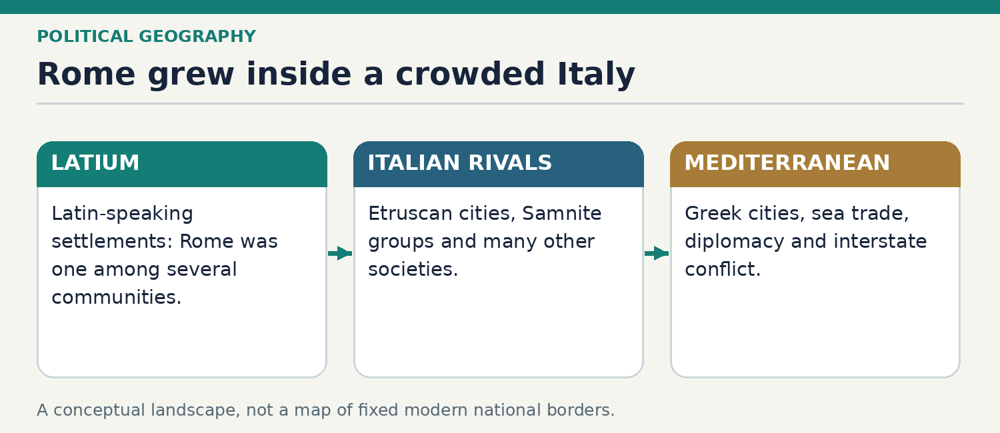

Rome stands beside the Tiber River in central western Italy, not at the heart of a naturally unified peninsula. The Apennine Mountains run down Italy; coastal plains and valleys connect settlements; and the Mediterranean makes travel and exchange possible. In the first millennium BCE, the peninsula was home to many peoples with distinct languages and political traditions. The Etruscans built wealthy city centers in central Italy. Greek-speaking communities flourished in southern Italy and Sicily. Samnite-speaking groups dominated parts of the central and southern mountains. Latin-speaking settlements clustered around Latium, the region of Rome.

Rome grew amid these contacts. Its religious rituals, architecture, material culture and political practices did not arise in isolation. Etruscan and Greek influences are visible in archaeology and later Roman traditions, although individual borrowing stories are often difficult to prove. The city's location made it one river crossing and regional market among many before it became the center of a remarkable political system. When later Romans described themselves as destined to rule the world, they were reading an extraordinary outcome backward into a much less certain beginning.

A map can mislead if it starts with the empire colored red and treats every province as an inevitable Roman possession. To understand how Rome grew, we must begin with a crowded landscape of <strong>rivals, allies, migrants and trading partners</strong>, each with its own political choices. Local conflict, adaptation and negotiated relationships mattered as much as geography.

<figure class="figure" id="figure-17-1">

<figcaption>Figure 17.1. Rome emerged among multiple Italian communities and Mediterranean connections. <a class="figure-anchor" href="#figure-17-1" aria-label="Link to this figure">#</a></figcaption>
</figure>
