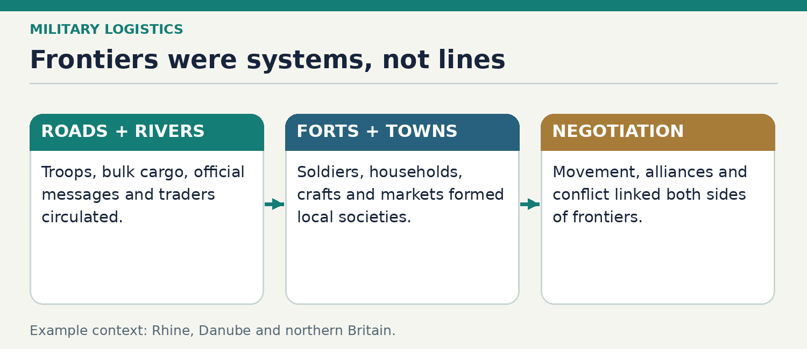

At its greatest territorial extent under Trajan in the early second century CE, Roman power reached from Britain to parts of Mesopotamia and from the Rhine and Danube to North Africa and Egypt. The precise borders shifted and were not always a solid, uninterrupted wall. Frontiers could be fortified, patrolled, negotiated and crossed. Traders, soldiers, diplomats, families and raiders passed through them. Hadrian's Wall in northern Britain is a famous physical example of frontier management, not evidence that Roman and non-Roman societies were sealed off from one another.

Roman roads carried troops, messages, taxes and goods. Engineers built durable paved routes in many areas, but rivers and sea lanes often moved bulk commodities more efficiently. Ports, harbors, warehouses, bridges and river fleets were essential. A Roman official in the Danubian provinces might depend on an intersecting system of land roads, river transport, military posts and local suppliers. The state could project force because it could move and feed people, not simply because a map was large.

The army was also a community. Soldiers served far from their birthplaces; auxiliary units recruited from provinces, and veterans might settle near former postings. Archaeological sites such as Vindolanda in Britain preserve letters and lists that reveal food, clothing, household relationships and ordinary worries alongside military orders. Such evidence complicates the familiar image of anonymous legions marching in perfect formation. <strong>A frontier was a social landscape, not just a defensive line.</strong>

<figure class="figure" id="figure-17-8">

<figcaption>Figure 17.8. Roman frontier regions integrated roads, rivers, forts, local markets and cross-border movement. <a class="figure-anchor" href="#figure-17-8" aria-label="Link to this figure">#</a></figcaption>
</figure>
