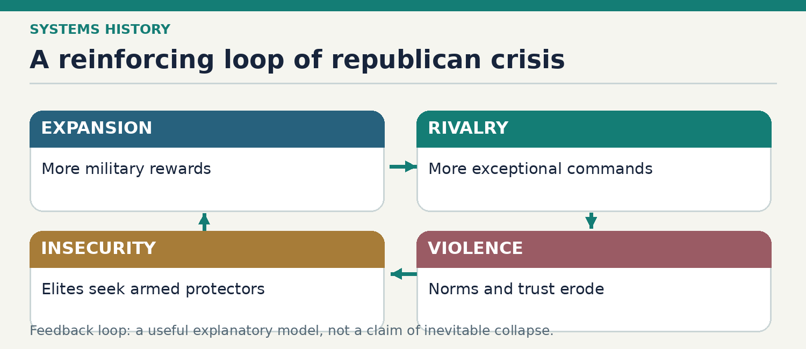

Roman armies changed over centuries; one tidy 'Marian reform' that instantly created professional legions is an oversimplification. Yet political dynamics unquestionably shifted as commanders cultivated loyalty through opportunities for booty, pay, land and advancement. Military victories gave individuals reputations and resources that could overpower ordinary institutional restraints. The relationship between soldiers, commanders, land distribution and political office became increasingly dangerous.

In 88 BCE, Sulla marched his army on Rome amid a conflict over command, crossing a norm of extraordinary importance. After civil war he imposed a dictatorship and political proscriptions in which enemies were targeted and property confiscated. He claimed to restore the Republic while using coercive personal power to reshape it. The precedent mattered even after Sulla retired: armed seizure of the capital had become imaginable as a political option.

One should not say that the Republic 'collapsed because democracy went too far' or because a single ambitious general wanted power. Social competition, conquest, institutional design, unequal wealth, political violence, the incentives of army commands and failures of elite compromise reinforced one another. Each crisis made the next harder to resolve. This is a historical <strong>feedback loop</strong>: civil conflict increases fear; fear justifies exceptional commands; exceptional commands weaken ordinary rules; weakened rules increase the attraction of armed protection.

<figure class="figure" id="figure-17-6">

<figcaption>Figure 17.6. Reinforcing mechanisms between conquest, command, competition and violence weakened republican restraint. <a class="figure-anchor" href="#figure-17-6" aria-label="Link to this figure">#</a></figcaption>
</figure>
