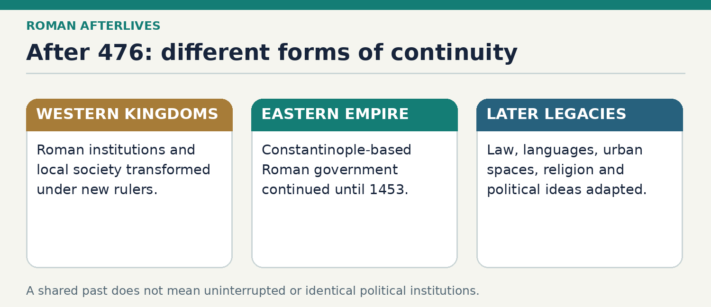

The eastern Roman government based at Constantinople survived the fifth-century political changes in the West. Modern historians commonly call its later history <strong>Byzantine</strong>, but its rulers and many subjects regarded themselves as Romans. Greek became the dominant administrative language over time, while political, legal and religious institutions changed dramatically. Under Justinian I in the sixth century, eastern armies recovered some former western territories, and imperial jurists produced the <strong>Corpus Juris Civilis</strong>, a major compilation and organization of Roman legal traditions.

The eastern empire confronted later wars with Persia, Arab-Muslim conquests, internal struggles, religious controversies and new regional powers. Its borders contracted and sometimes recovered. It remained an important actor in eastern Mediterranean and Balkan history for centuries. Constantinople fell to Ottoman forces in <strong>1453</strong>, a date of enormous consequence but not a reason to flatten the preceding thousand years into one unchanging 'Roman survival.' Eastern Roman history deserves a separate chapter in the larger narrative.

Western post-Roman rulers, the medieval papacy and later European governments also claimed, adapted or reinterpreted Roman authority. Medieval lawyers studied Roman texts; Latin and Romance languages carried Roman linguistic legacies; roads and city sites shaped later settlement. Yet an influence is not proof of uninterrupted institutional continuity. The Roman Senate, the medieval Holy Roman Empire, modern parliaments and modern citizenship systems are historically distinct even when their participants borrowed vocabulary and symbols from antiquity.

<figure class="figure" id="figure-17-12">

<figcaption>Figure 17.12. The western imperial court ended, but eastern Roman government and multiple Roman legacies continued. <a class="figure-anchor" href="#figure-17-12" aria-label="Link to this figure">#</a></figcaption>
</figure>
