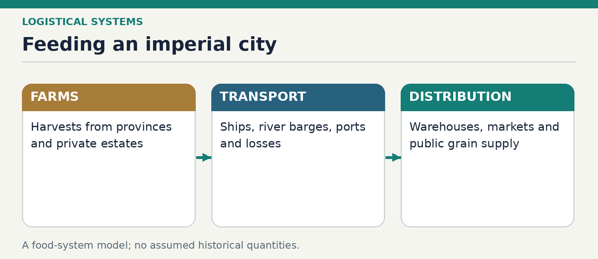

Rome's economy mixed household production, agriculture, private exchange, state requisition, taxation, public building, military expenditure and forms of coerced labor. The scale of Mediterranean commerce was remarkable, but the empire did not have an industrial economy, modern national accounts or a unified free market. Local prices, transport costs, labor relations and property rights varied. Some cities were wealthy commercial centers; many people remained tied to rural production.

The city of Rome depended on huge food networks. Grain from Africa, Sicily and Egypt supplied the capital, with the <strong>annona</strong>—state involvement in grain supply and distribution—becoming politically significant. A bad harvest or interrupted shipping route could have consequences far beyond a rural district. Sea transport was often cheaper for bulk food than moving it over great land distances. Aqueducts, baths and streets symbolize urban life, but warehouses, ports and records of taxation may tell us more about how such cities survived.

Consider a <strong>fictional exercise</strong>: a city needs 600 tonnes of grain each month. If 20 percent is lost during transport and storage, how much must be shipped? Divide 600 by 0.8: <strong>750 tonnes</strong>. This arithmetic is not an estimate of Roman historical shipments; it demonstrates a systems problem. Administrators had to account for losses, variable seasons and transportation capacity. Political authority was partly the ability to manage such problems. It was also the ability to decide who bore the costs of managing them.

<figure class="figure" id="figure-17-9">

<figcaption>Figure 17.9. The grain supply linked distant agricultural provinces to imperial cities and political authority. <a class="figure-anchor" href="#figure-17-9" aria-label="Link to this figure">#</a></figcaption>
</figure>
