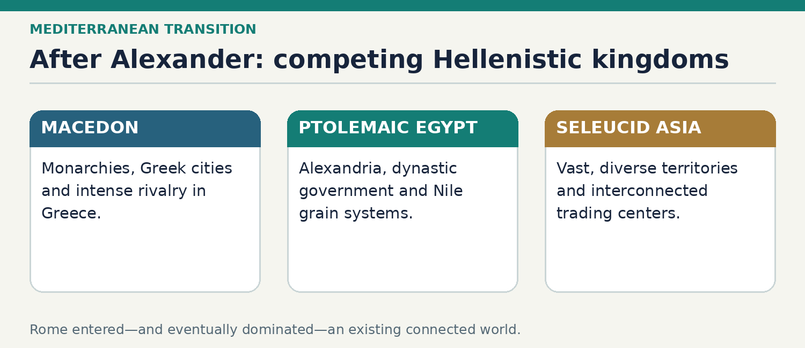

Chapter 16 described the Greek poleis, but their world did not simply vanish after Athens and Sparta fought. Philip II of Macedon defeated a coalition of Greek states at Chaeronea in 338 BCE. His son Alexander conquered the Achaemenid Persian Empire before dying in Babylon in 323 BCE. Rival successors—often called the <em>Diadochi</em>—created competing Hellenistic dynasties in Egypt, Macedon and western Asia. Cities such as Alexandria became centers of scholarship, trade and royal display. Greek language and cultural practices circulated alongside Egyptian, Iranian, Mesopotamian and other traditions, producing new combinations rather than a simple replacement of local cultures.

Rome entered this world as an Italian republic initially less prestigious than great monarchies. Over the second and first centuries BCE, it defeated Macedonian armies, intervened in Greek affairs and transformed relationships with Hellenistic kingdoms. It destroyed Corinth in 146 BCE and extended its power in Greece, yet its ruling elite eagerly collected Greek art, studied Greek philosophy and employed Greek teachers. Rome could conquer politically while absorbing culturally.

The last Ptolemaic ruler of Egypt, Cleopatra VII, governed a kingdom rooted in this Hellenistic world. Her conflict and alliances with Roman leaders belonged to a longer struggle over the eastern Mediterranean, not simply a romantic subplot. The conventional Hellenistic period ends around 31/30 BCE with Actium and the end of independent Ptolemaic rule; cultural and intellectual traditions continued beyond that political marker. Rome's story is thus also the story of <strong>how older civilizations were reorganized within a new imperial order</strong>.

<figure class="figure" id="figure-17-4">

<figcaption>Figure 17.4. After Alexander, successor kingdoms supplied the political and cultural world into which Rome expanded. <a class="figure-anchor" href="#figure-17-4" aria-label="Link to this figure">#</a></figcaption>
</figure>
