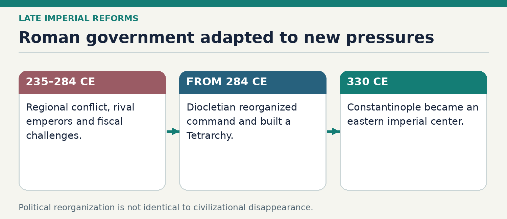

During much of the third century CE, emperors faced military rebellions, rival claimants, frontier attacks, fiscal challenges and disruptions in coinage and administration. Historians refer to a <strong>Crisis of the Third Century</strong>, especially the period 235–284 CE. But 'crisis' should not imply that every province experienced identical economic collapse. Evidence varies significantly between regions; urban building, trade and local life followed different paths.

Diocletian, who came to power in 284, reorganized imperial administration and government. His <strong>Tetrarchy</strong> assigned power to two senior emperors and two junior colleagues in an attempt to manage military threats and succession across a vast territory. It was an inventive response to systemic difficulties, but rivalries persisted. Constantine eventually consolidated sole rule and established Constantinople on the site of Byzantium as an imperial center in 330 CE. These changes demonstrate that Rome adapted institutions when earlier arrangements proved inadequate.

The transformation brought costs as well as benefits. Taxation and bureaucracy could become more demanding; imperial intervention in religious life expanded; the army and court changed in composition. Older images of a 'classical Rome' sometimes make these adaptations look like simple decline. A better question asks what problem each reform tried to solve and what new tensions it produced. An empire that reorganizes its capital and administrative structure is not necessarily an empire that has stopped functioning.

<figure class="figure" id="figure-17-11">

<figcaption>Figure 17.11. The third-century crisis prompted political and administrative reorganization rather than uniform disappearance. <a class="figure-anchor" href="#figure-17-11" aria-label="Link to this figure">#</a></figcaption>
</figure>
