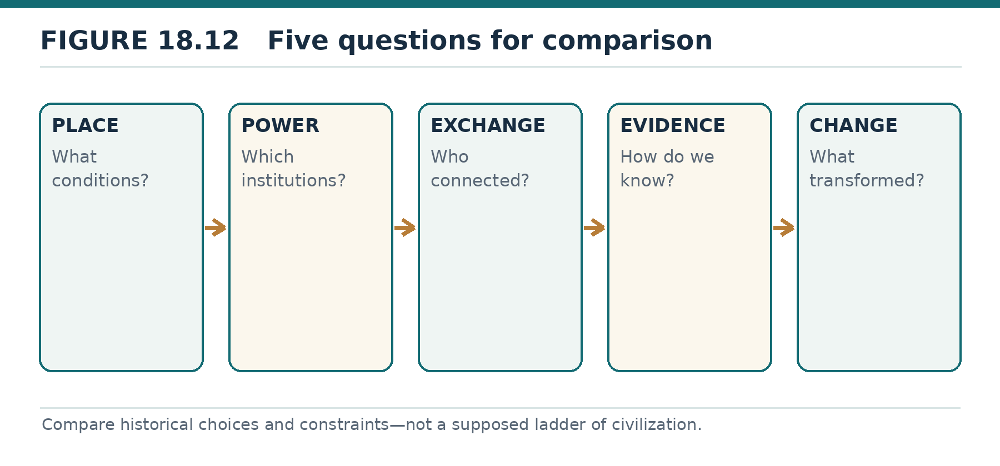

What have we learned? First, Africa contributed multiple major traditions of state formation: Nile kingdoms, highland polities, Sahelian empires, urban coastal communities and kingdoms of western and central Africa. Second, prosperity often depended on interregional exchange, but the resources and institutions behind commerce were local. Third, archaeological objects, oral traditions, inscriptions and outside chronicles each require critical interpretation. Fourth, political change does not equal cultural extinction.

The next chapters will return to patterns this chapter introduced. The rise and spread of Islam changed commercial and intellectual connections in North and West Africa as well as farther east. Atlantic expansion and the slave trades later reshaped political economies and inflicted deep harm on millions of people. Colonial conquest and anticolonial movements transformed borders and states. None of these developments makes sense if Africa's earlier history is treated as a blank page. African actors were never merely background figures in other people's stories.

The most useful sentence to carry forward is simple: <strong>there is no single African historical trajectory</strong>. The continent's societies were diverse, historically connected, innovative, unequal, adaptable and constantly changing—much like societies elsewhere. Their differences, not an invented uniformity, make them central to a serious account of world history.

<figure class="figure" id="figure-18-12">

<figcaption>Figure 18.12. Compare historical choices and constraints—not a supposed ladder of civilization. <a class="figure-anchor" href="#figure-18-12" aria-label="Link to this figure">#</a></figcaption>
</figure>
