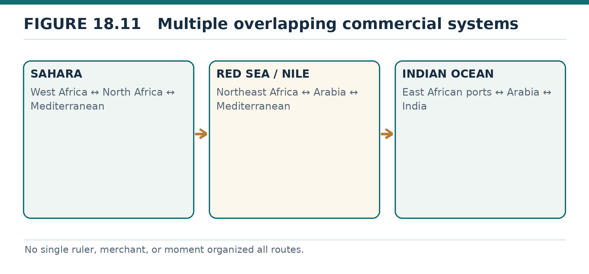

Consider three overlapping commercial systems. In the Sahara, merchants linked Sahelian markets and North African towns. On the East African coast, ports coordinated Indian Ocean exchange. On the Nile and Red Sea, routes connected inland kingdoms with the Mediterranean and Arabia. These systems sometimes intersected through further trade, but no single merchant controlled all three. They also changed at different times. A network diagram helps show connections without pretending that all goods followed one direct route from mine to customer.

<figure class="figure" id="figure-18-11">

<figcaption>Figure 18.11. No single ruler, merchant, or moment organized all routes. <a class="figure-anchor" href="#figure-18-11" aria-label="Link to this figure">#</a></figcaption>
</figure>

Imagine a hypothetical exchange chain with four intermediaries between a source producer and final buyer. If the producer receives 10 units of value, and each intermediary adds 20 percent to the price to cover costs and margin, the final price is 10 × 1.2^4 = 20.736 units. That calculation is a teaching model, not a historical estimate of medieval African trading margins. It shows that a distant market price cannot be equated with the earnings of the original producer. Costs, risk, bargaining power and political taxation affect distribution along a route.

Political authorities might profit from trade by charging tolls, regulating markets, providing security or controlling strategic nodes. But the existence of imported luxury goods in a capital does not establish that every resident benefited. A city might grow rich while its hinterland supplied coerced labor. A route might flourish for merchants while exposing travelers or local communities to raiding. <strong>Connectivity creates opportunity and unequal vulnerability at the same time.</strong>
