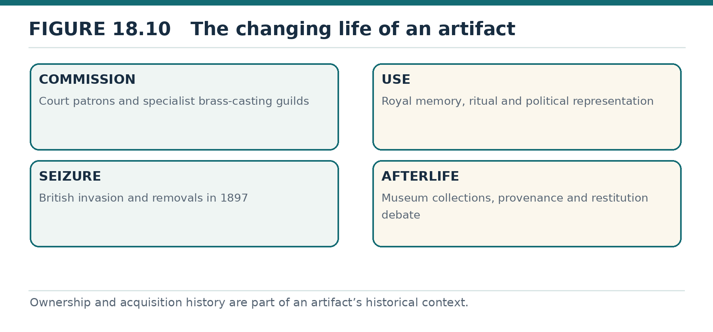

The kingdom of Benin, centered on Benin City in present-day Nigeria, was a major Edo-speaking polity. It is not the same as today's Republic of Benin. Its monarch, the <em>oba</em>, exercised authority in a political world that also included titled officials, palace guilds, merchants, towns and neighboring communities. Royal power changed over time and should not be imagined as unlimited personal command. The court commissioned impressive brass castings, ivory works and carved objects that preserved memory, hierarchy and ritual obligations.

Some commemorative brass plaques depict rulers, warriors, attendants and encounters with foreigners. These objects show the skills of specialist casting guilds and the significance of royal imagery. They can also help identify patterns of contact with Portuguese traders and other visitors from the late fifteenth century onward. But court art primarily reflects particular patrons and purposes; the people who grew food, maintained households and experienced royal demands often appear less directly in its imagery.

In 1897 British forces invaded Benin City and removed large quantities of royal and sacred objects. Many later entered museums and private collections outside Nigeria. This violent removal has consequences for scholarship as well as cultural ownership: objects became separated from the places, institutions and records that could explain them. Current discussions of restitution are not distractions from history; they concern how evidence was acquired and how its meaning and custody should be understood. The history of an artifact includes the circumstances of its survival and movement.

<figure class="figure" id="figure-18-10">

<figcaption>Figure 18.10. Ownership and acquisition history are part of an artifact’s historical context. <a class="figure-anchor" href="#figure-18-10" aria-label="Link to this figure">#</a></figcaption>
</figure>
