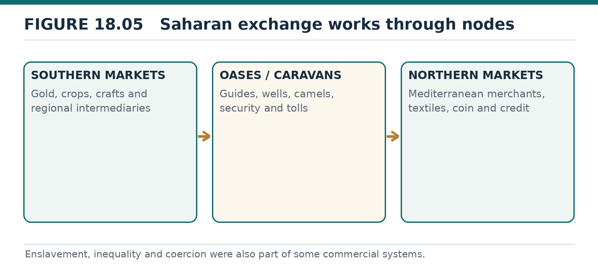

Between roughly the early medieval centuries and the early modern period, trans-Saharan commercial networks connected parts of West Africa, North Africa and the Mediterranean. Camel caravans were central to many of these routes because they enabled longer journeys across arid terrain. Their effectiveness depended on established knowledge of wells, seasons, local rulers and markets. Even then, water shortages, taxation, robbery and unstable alliances could threaten a journey. The economic value of a route was never independent of the political conditions that made passage safer—or more dangerous.

Gold from parts of West Africa was especially important to wider commercial systems, and salt from desert-producing regions could command demand farther south. But reducing trans-Saharan trade to a two-item exchange hides textiles, copper, horses, manuscripts, food, enslaved people and other goods, as well as the human consequences of coercive trade. Enslavement existed in various forms across societies; the routes helped move captives and shaped local conflicts. Their experiences must not disappear beneath the celebratory language of commerce.

Merchants relied on more than barter. Trust networks, credit arrangements, shared religious and legal knowledge, and intermediaries helped transactions cross political boundaries. Islam created important intellectual and institutional connections across the Sahara, but neither every ruler nor every merchant held the same beliefs, and local religious practices remained influential. Roads and caravans reveal an ancient lesson of systems thinking: <strong>trade routes are networks of institutions, not just lines between points</strong>.

<figure class="figure" id="figure-18-5">

<figcaption>Figure 18.5. Enslavement, inequality and coercion were also part of some commercial systems. <a class="figure-anchor" href="#figure-18-5" aria-label="Link to this figure">#</a></figcaption>
</figure>
