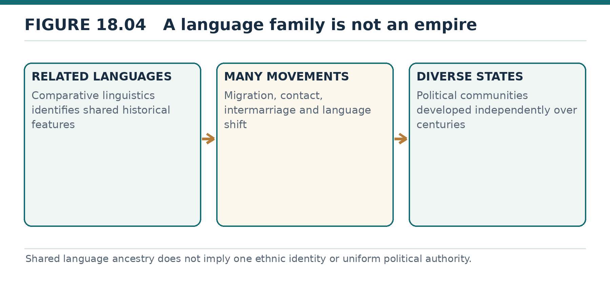

One of the largest patterns in African linguistic history is the spread of Bantu languages across wide parts of central, eastern and southern Africa over many centuries. The label 'Bantu' identifies a linguistic grouping, not a single nation, race, empire or migrating army. Researchers use comparative linguistics, archaeology and genetics to investigate the movements, contacts and mixing that contributed to this distribution. The process unfolded through repeated migrations and local interactions, not one sudden march across a blank continent.

Many communities cultivated crops, kept livestock, worked iron and adapted to forests, savannas or river valleys in different combinations. A technology could spread without every user migrating from the same place. A language could spread while speakers intermarried with established populations and adopted local practices. Archaeologists therefore resist equating one ceramic style with one ethnic group or treating every movement of people as cultural replacement.

The expansions matter because they help explain connections among languages spoken today in places as widely separated as the Congo Basin, the Great Lakes and southern Africa. They do not erase the histories of earlier populations or the many non-Bantu linguistic communities throughout the continent. Language is a valuable historical clue, but <strong>a linguistic family is not a political map</strong>.

<figure class="figure" id="figure-18-4">

<figcaption>Figure 18.4. Shared language ancestry does not imply one ethnic identity or uniform political authority. <a class="figure-anchor" href="#figure-18-4" aria-label="Link to this figure">#</a></figcaption>
</figure>
