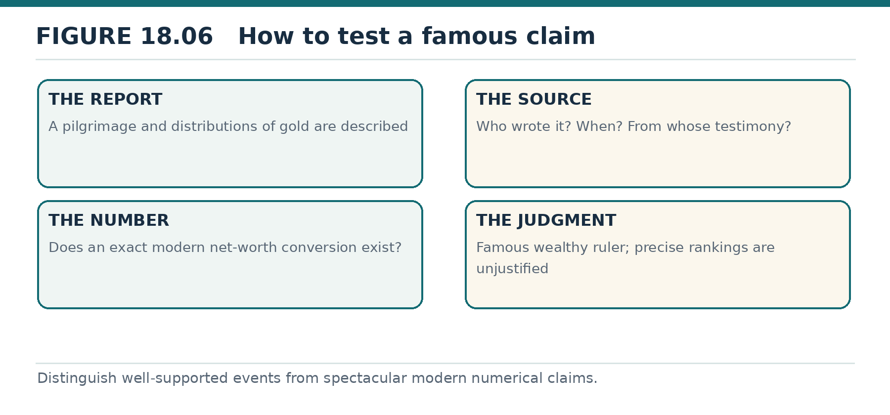

In 1324–1325, Mali's ruler Mansa Musa traveled on pilgrimage to Mecca, passing through Cairo. The journey drew attention from observers far beyond West Africa, and later accounts describe large retinues and substantial distributions of gold. It is often presented as proof that Musa was 'the richest person who ever lived.' Such a modern ranking cannot be calculated meaningfully from medieval evidence: property, sovereignty, purchasing power and personal wealth operated under different institutions, and the quantities in surviving narratives are uncertain.

The significance of the journey is clearer than its popular numerical embellishments. Musa's pilgrimage connected Mali to influential Muslim communities and political networks, publicized the kingdom's wealth, and supported relationships with scholars and merchants. It also makes visible the intersection of kingship and religious prestige. The trip was both a devotional act and an event with diplomatic and economic consequences.

Some chroniclers report effects on the price of gold in Cairo, but the scale and duration of the impact are debated and depend on the quality of later testimony. Instead of repeating a spectacular estimate, ask: who recorded the story, how long after the event, which quantities are plausible, and what other independent evidence exists? The lesson from Chapters 3 and 4 applies here: <strong>precision in a source is not the same as certainty about the past</strong>.

<figure class="figure" id="figure-18-6">

<figcaption>Figure 18.6. Distinguish well-supported events from spectacular modern numerical claims. <a class="figure-anchor" href="#figure-18-6" aria-label="Link to this figure">#</a></figcaption>
</figure>
