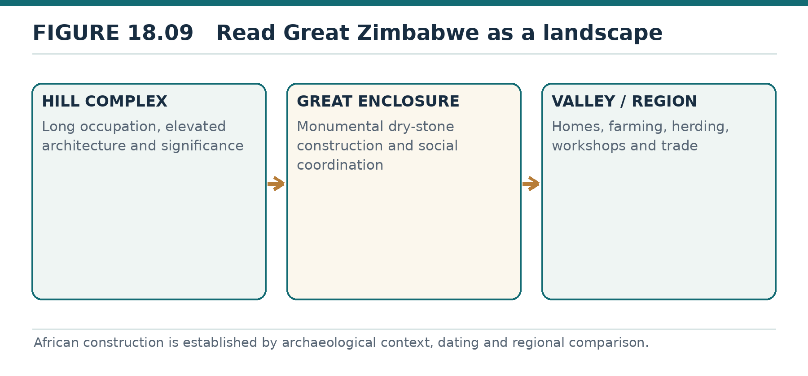

The history of southern African kingdoms challenges any assumption that monumental cities existed only near the Nile or Mediterranean. Mapungubwe, near the confluence of the Limpopo and Shashe rivers in present-day South Africa, flourished during the eleventh to thirteenth centuries. Its archaeological record reveals growing settlement hierarchy, trade goods, elite burials and a famous gold-covered rhinoceros. None of these objects speaks directly, but together they show a regional center where prestige, authority and exchange had become closely connected.

Great Zimbabwe, in present-day Zimbabwe, developed into a major stone-built political center, especially between approximately the eleventh and fifteenth centuries. Its walls, passages and enclosures are associated with communities ancestral to Shona-speaking peoples. The structures were built with carefully fitted stone, often without mortar. The complex included multiple areas of occupation and ritual or political significance; it was not merely one 'royal palace' standing apart from a featureless population. Its wealth was connected to cattle, agriculture, regional exchange and access to gold-producing areas.

Archaeologists have found imported objects including beads and ceramics that connect Great Zimbabwe to Indian Ocean commerce. They do not imply that foreign merchants built its walls. Colonial-era writers sometimes denied the site's African origins and invented outsiders as its architects. Archaeological investigation, dating and regional comparison have decisively undermined those claims. This is a case study in how prejudice can distort questions before the evidence is even examined. <strong>The method matters: date the site, study the construction, compare local material traditions and resist preferred myths.</strong>

<figure class="figure" id="figure-18-9">

<figcaption>Figure 18.9. African construction is established by archaeological context, dating and regional comparison. <a class="figure-anchor" href="#figure-18-9" aria-label="Link to this figure">#</a></figcaption>
</figure>
