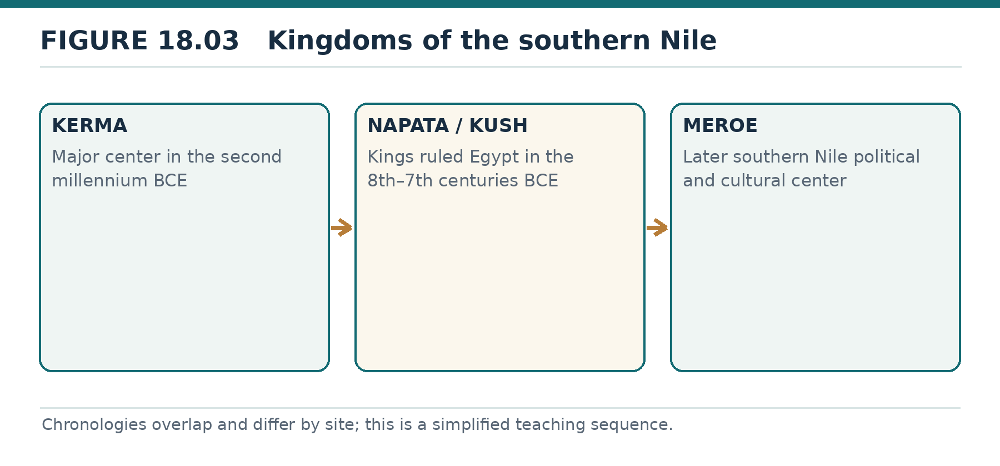

The Nile was not solely an Egyptian river. South of Egypt, communities in what is now Sudan developed agricultural, pastoral and urban traditions with their own political histories. Kerma emerged as an important center during the second millennium BCE, associated with monumental mud-brick architecture, wealthy burials and regional power. Egyptian rulers sometimes campaigned southward, while people and goods moved in both directions. The relationship included warfare, exchange, borrowing and resistance; labeling the entire area simply 'Egypt's southern frontier' would make the neighbors disappear from the story.

Later, a Kushite kingdom centered on Napata became a major force. In the eighth and seventh centuries BCE, Kushite rulers governed Egypt as its Twenty-fifth Dynasty. The famous 'Black Pharaohs' designation highlights their African origin but can obscure the long-established cultural and political sophistication of the Nile's southern societies. Their leaders used Egyptian religious and royal symbols while making political choices in their own strategic environment. Assyrian campaigns and shifting regional power eventually ended Kushite rule in Egypt; that did not end Kush itself.

The political and ceremonial center associated with Kush later shifted toward Meroë. The region supported distinctive art, architecture, pyramids, writing in the Meroitic script, and networks linking the Nile to wider African and Red Sea worlds. The extent, organization and chronology of iron production have been debated; it is unwise to repeat simplified claims that every Meroitic furnace supplied a vast export industry. The history that survives is rich enough without forcing an exaggerated narrative of either borrowed civilization or isolated invention. Kush was a participant in broader northeastern African history, not merely an episode inside Egypt's story.

<figure class="figure" id="figure-18-3">

<figcaption>Figure 18.3. Chronologies overlap and differ by site; this is a simplified teaching sequence. <a class="figure-anchor" href="#figure-18-3" aria-label="Link to this figure">#</a></figcaption>
</figure>
