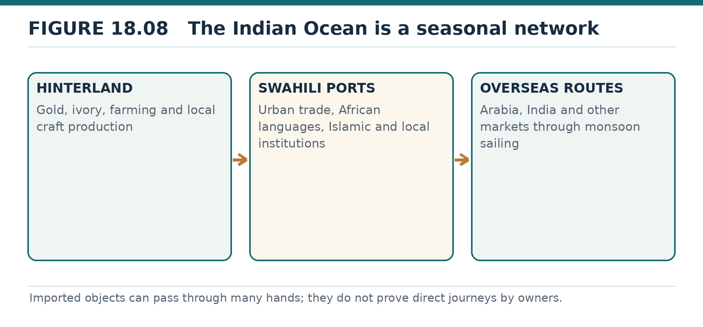

Along the eastern African coast, communities developed ports and towns whose inhabitants spoke forms of Swahili, a Bantu language with a long history of contact and borrowing. Towns such as Kilwa, Mombasa, Malindi and others participated in an Indian Ocean commercial world linking mainland Africa to Arabia, Persia, India and, through further networks, China. Monsoon winds helped shape seasonal sailing, but ships did not carry wealth automatically. Sailors, port authorities, merchants, craftspeople and hinterland suppliers created the networks.

From the medieval centuries onward, some towns built coral-stone houses and mosques, minted coins or received imported ceramics. Kilwa Kisiwani became especially important to the exchange of goods from inland southern Africa, including gold and ivory. Its architecture is evidence of urban organization and Islamic cultural life, while imported porcelain is evidence of long-distance connections. A porcelain bowl in an East African dwelling does not prove that its owner visited China: goods often changed hands many times before reaching their users.

Older colonial narratives sometimes claimed that Swahili civilization must have been founded by foreigners because its cities displayed sophisticated architecture and traded across oceans. Archaeology and linguistic research strongly support the role of local African communities in developing these towns, while also demonstrating sustained overseas exchange, intermarriage and cultural adaptation. These findings permit a richer explanation: <strong>African origins and global connections are not competing alternatives</strong>. A city can be deeply local and profoundly cosmopolitan at the same time.

<figure class="figure" id="figure-18-8">

<figcaption>Figure 18.8. Imported objects can pass through many hands; they do not prove direct journeys by owners. <a class="figure-anchor" href="#figure-18-8" aria-label="Link to this figure">#</a></figcaption>
</figure>
