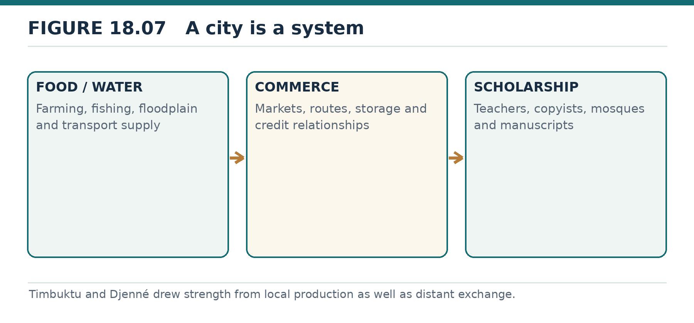

Timbuktu developed into an influential commercial and intellectual center on the southern edge of the Sahara, connected to Niger River networks. Djenné and the wider Inland Niger Delta supported agriculture, craft production and exchange over long periods. Mud-brick architecture, mosques, manuscripts and urban landscapes show how scholarship and commerce could reinforce one another. The cities' significance changed over time; neither was permanently dominant nor insulated from war and shifting routes.

Scholars in Timbuktu studied fields including Islamic jurisprudence, theology, grammar and aspects of mathematics and astronomy. Manuscripts survive in public and family collections, though not every document attributed to the city was written there. They show traditions of copying, commentary, ownership and scholarship. Calling Timbuktu 'Africa's university' can convey its intellectual importance, but the phrase risks imposing the institutional structure of a modern university on a different educational world of teachers, students, mosques and private libraries.

A visitor might have encountered several social worlds at once: caravan merchants arranging commercial transactions, river traders moving grain, scribes preparing documents, scholars debating legal questions, and craftspeople maintaining earthen buildings. Economic resilience relied on both local food production and distant routes. These cities complicate the false opposition between 'African oral tradition' and 'written civilization': oral and written knowledge existed alongside each other and served different social purposes.

<figure class="figure" id="figure-18-7">

<figcaption>Figure 18.7. Timbuktu and Djenné drew strength from local production as well as distant exchange. <a class="figure-anchor" href="#figure-18-7" aria-label="Link to this figure">#</a></figcaption>
</figure>
