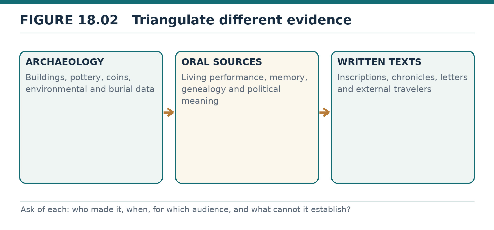

Some African societies produced written chronicles, inscriptions, legal texts, religious literature and correspondence. Others are known especially through archaeology, oral traditions, linguistic reconstruction, art and objects made for daily use. In still other cases, written observers from another region—such as Arabic-speaking geographers or European merchants—left descriptions that reveal valuable details while also carrying misunderstandings and prejudices. A documentary gap does not mean that history did not happen. It means that historians must ask different questions of different forms of evidence.

Consider three objects. A coin bearing an Aksumite king's name can help date a ruler and illuminate state claims, while its metal and findspot suggest commercial connections. A gold weight or glass bead recovered from an inland settlement can indicate exchange but cannot identify every trader along its path. A royal commemorative brass plaque made in Benin can reveal artistic practice, court hierarchy and political imagery, although it is not a neutral census of the kingdom. These objects become more informative when researchers compare them with architecture, environmental findings, radiocarbon dates and independent records.

Oral traditions deserve neither automatic dismissal nor uncritical treatment as literal transcripts. They may preserve memories of migration, political foundation, kinship and legitimacy, yet performances change in response to audiences and present concerns. The story of Sundiata, for example, has been transmitted through West African epic traditions whose versions and purposes vary. It is evidence about memory and authority even where precise events cannot be confirmed. A good historian keeps two questions separate: <strong>what does the tradition say, and what can we independently establish about the past?</strong>

<figure class="figure" id="figure-18-2">

<figcaption>Figure 18.2. Ask of each: who made it, when, for which audience, and what cannot it establish? <a class="figure-anchor" href="#figure-18-2" aria-label="Link to this figure">#</a></figcaption>
</figure>
