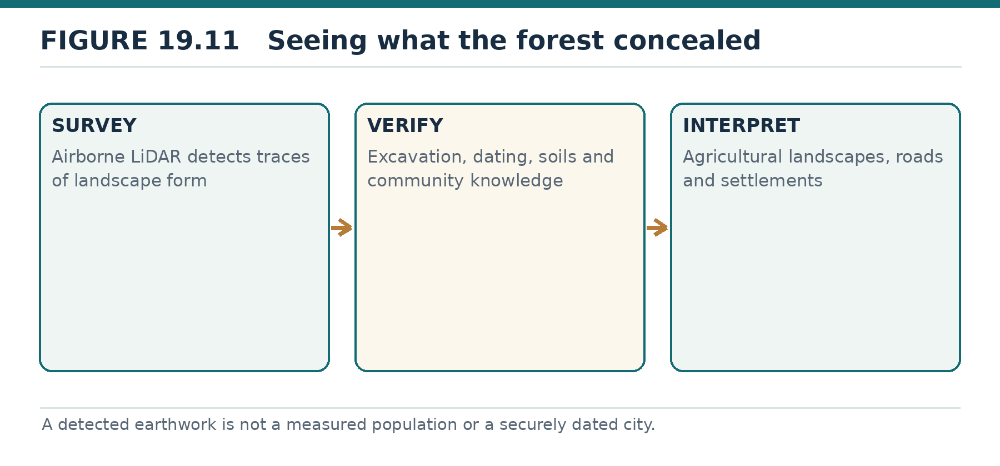

For a long time, many accounts described the Amazon Basin as a largely unmodified wilderness whose soils could not support large-scale settlement. Research increasingly shows a more varied past. Communities modified landscapes through managed forests, raised fields, canals, roads, fish weirs, planted trees and settlements at different densities. The famous term 'terra preta' refers to fertile dark soils in some Amazonian areas associated with long histories of human activity. But one discovery does not prove that every part of the immense basin contained cities.

LiDAR—light detection and ranging—has been especially revealing. Aircraft-based laser measurements can help researchers model the shape of land surfaces beneath portions of dense vegetation. A 2024 study of Ecuador's Upano Valley documented networks of platforms, plazas, agricultural features and roads associated with an extended history of low-density urbanism. Research on the Casarabe culture in today's Bolivia has likewise identified earthworks and connected settlement landscapes, and subsequent evidence has strengthened accounts of intensive maize-based production there. These are significant findings because they overturn the false choice between 'dense stone city' and 'empty forest.'

A LiDAR image is not a time machine. It detects forms in the landscape; archaeologists still must test dates, construction phases, functions and possible relationships between features. A rectangular rise might be an ancient platform or a product of a later process until the context is studied. Estimates of population and regional integration remain uncertain, and not all features were necessarily occupied simultaneously. <strong>New technologies expand the visible archive, but careful fieldwork and Indigenous knowledge remain essential to interpretation.</strong>

<figure class="figure" id="figure-19-11">

<figcaption>Figure 19.11. A detected earthwork is not a measured population or a securely dated city. <a class="figure-anchor" href="#figure-19-11" aria-label="Link to this figure">#</a></figcaption>
</figure>
