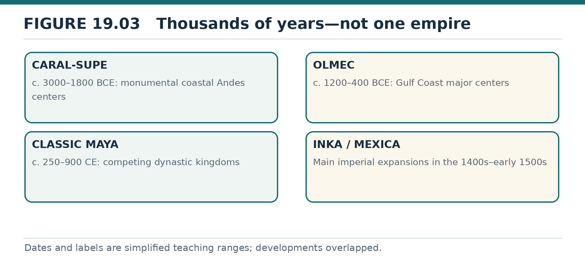

On a terrace above the Supe Valley of coastal Peru, the monumental center of Caral formed part of a wider landscape of settlements. Archaeological dating places its main development in the third and early second millennia BCE, often summarized as approximately 3000–1800 BCE. The site contains large platform structures, plazas and evidence of organized activity. Because the coastal desert is exceptionally dry, river-water management and connections with the irrigable valley were important. Nearby coastal communities also drew on marine resources, creating possibilities for exchange between inland crops and seafood.

Caral illustrates both achievement and interpretive restraint. Monumental architecture indicates the mobilization of labor and shared purposes; it does not, by itself, reveal an exact constitution, the names of rulers or a single 'first empire.' Archaeologists disagree over the balance between religious authority, economic coordination, hierarchical power and the many communities involved. We should resist replacing a myth of unchanging simplicity with an equally unsupported myth of an all-commanding ancient state.

Caral's chronology matters for global comparison. It developed long before the Classical Maya or the Inka Empire. Calling all three 'ancient Peru' hides the many centuries separating them. The same geography was repeatedly reorganized by later peoples, but they did not live inside one uninterrupted empire. When historians say a civilization was 'early,' they must specify <em>early compared with what</em>, and which elements—cities, agricultural intensification, monumental building, political integration or writing—are being compared.

<figure class="figure" id="figure-19-3">

<figcaption>Figure 19.3. Dates and labels are simplified teaching ranges; developments overlapped. <a class="figure-anchor" href="#figure-19-3" aria-label="Link to this figure">#</a></figcaption>
</figure>
