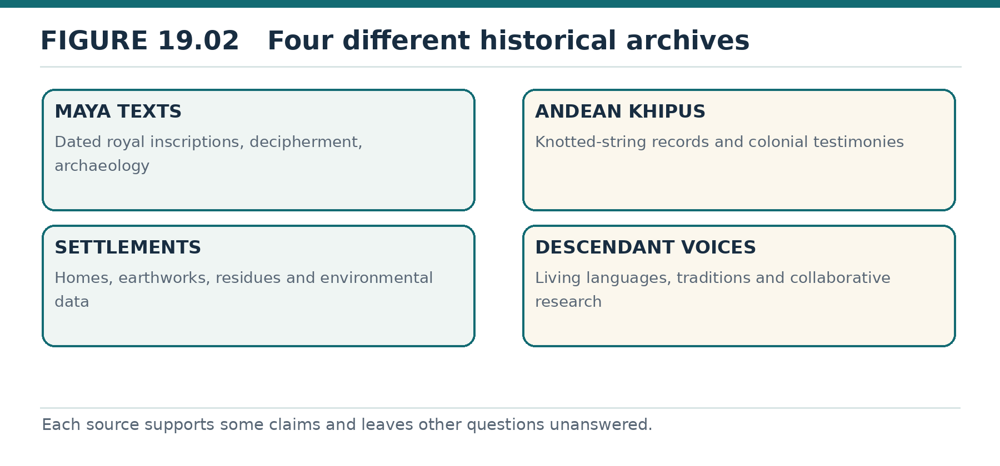

The sources differ sharply by region. In Maya cities, stone monuments and surviving painted or written materials give scholars direct access to some dates, rulers and events. In Central Mexico, Indigenous pictorial histories, colonial-era manuscripts and archaeological remains help reconstruct the recent preconquest past, though all require attention to when and why they were made. In the Andes, architecture, roads, state storehouses, textiles and khipus—knotted-string recording systems—are essential, while much written testimony was recorded after the conquest. Elsewhere, settlement patterns, soil, animal bones, ceramics, burial practices, landscapes and descendant oral histories may carry the main evidentiary burden.

Written sources are not inherently impartial. A Maya king's carved victory declaration tells us what that court wanted remembered, not necessarily the entire military outcome. A Spanish conqueror's description of a city can preserve valuable detail while also advancing a political case to an overseas monarch. A missionary's account may record Indigenous beliefs while translating them through unfamiliar categories. An archaeological floor, a palace inscription and a later oral tradition may all answer different questions. Strong histories test where independent lines of evidence meet—and state openly when they do not.

Indigenous communities are not only the subjects of research. Their languages, stewardship, oral traditions and participation can transform archaeological questions and interpretations. Names such as 'Aztec' and 'Inca' are convenient but imprecise labels when used as if they describe every person in an empire. <em>Mexica</em> often refers more specifically to the people centered on Tenochtitlan and Tlatelolco; <em>Tawantinsuyu</em> refers to the Inka imperial realm. Even 'Maya' describes many related but distinct communities across time. A historical label is a tool, not a substitute for precision.

<figure class="figure" id="figure-19-2">

<figcaption>Figure 19.2. Each source supports some claims and leaves other questions unanswered. <a class="figure-anchor" href="#figure-19-2" aria-label="Link to this figure">#</a></figcaption>
</figure>
