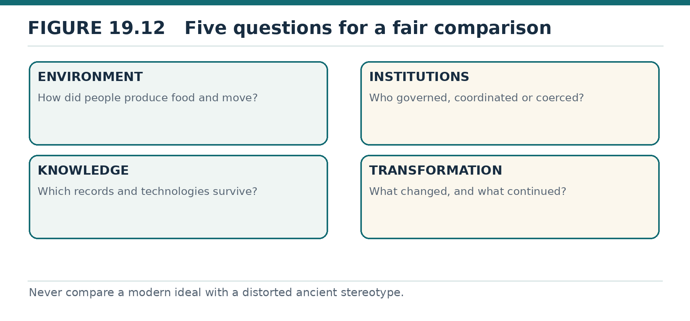

Three comparisons reveal why labels matter. Classic Maya cities were governed through competing dynastic kingdoms, not a unified Maya empire. The Mexica-led Triple Alliance expanded through tributary relationships over a patchwork of local powers, while its capital drew on an intensively managed lake economy. Tawantinsuyu coordinated immense labor and communication systems across mountains and deserts. All exhibited forms of hierarchy, ritual power, political negotiation and conflict; they differed in administrative technologies, territorial organization and the relations between local and central elites.

North America's diverse political arrangements are equally important. Cahokia was a populous ceremonial and political center within Mississippian networks, while the ancestral Pueblo world included changing regional communities and shared architectural traditions. Other nations organized councils, diplomacy, clan relationships and seasonal movement without building comparably large monuments. One should not rank societies by their resemblance to Rome. Better questions concern resilience, social participation, ecological management, coercion, legitimacy and evidence.

A useful distinction is between a <em>civilization</em> as a broad historical and cultural category, a <em>state</em> as a form of organized political power, a <em>city</em> as a type of settlement and an <em>empire</em> as an extended power relationship among different groups. These are not synonyms. Indigenous societies could have far-reaching culture without one state; a powerful city could exist without ruling every nearby community. The term 'pre-Columbian' is likewise a chronological convenience, not an Indigenous self-description or a declaration that later history does not count.

<figure class="figure" id="figure-19-12">

<figcaption>Figure 19.12. Never compare a modern ideal with a distorted ancient stereotype. <a class="figure-anchor" href="#figure-19-12" aria-label="Link to this figure">#</a></figcaption>
</figure>
