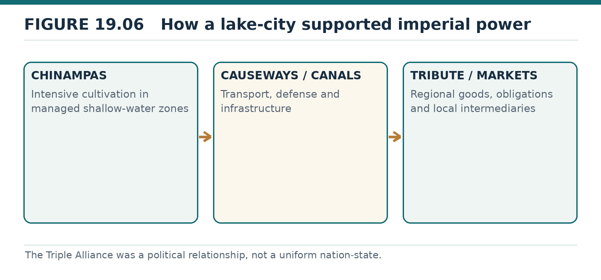

The Mexica established Tenochtitlan on islands in Lake Texcoco, traditionally dated to 1325 in their later historical accounts. During the fifteenth century, a coalition commonly called the Triple Alliance—Tenochtitlan, Texcoco and Tlacopan—expanded its power. Tribute obligations from conquered communities provided goods, labor and political recognition, but administration was not identical everywhere. Local elites often remained important, and resistance was recurrent. Modern shorthand 'Aztec Empire' usually refers to the coalition's dominance, not a nation-state with uniform borders and citizenship.

Tenochtitlan's scale rested on engineering and commerce as well as warfare. Raised causeways connected the island city to the shore; aqueducts and water management addressed urban needs; markets circulated products from surrounding areas; and chinampa cultivation generated intensive food production in suitable shallow lake environments. Cholula, Tlatelolco, Texcoco and other centers were part of a much larger political and economic world. Estimates of the capital's population vary, and confident round numbers should be treated as estimates rather than census facts.

Religion and military power were intertwined. Public ceremonial practice, sacrifice, and imperial ideology mattered to governing elites, but sensational descriptions written after conquest often require verification and context. Coerced labor, tribute, captive-taking and resistance were real political issues; so were craft skill, poetry, education and the routines of ordinary households. A good account refuses to make one dramatic aspect stand for an entire civilization. It also remembers that the people who confronted Spanish forces in 1519–1521 included many Indigenous groups with conflicting aims, not a simple contest between two homogeneous sides.

<figure class="figure" id="figure-19-6">

<figcaption>Figure 19.6. The Triple Alliance was a political relationship, not a uniform nation-state. <a class="figure-anchor" href="#figure-19-6" aria-label="Link to this figure">#</a></figcaption>
</figure>
