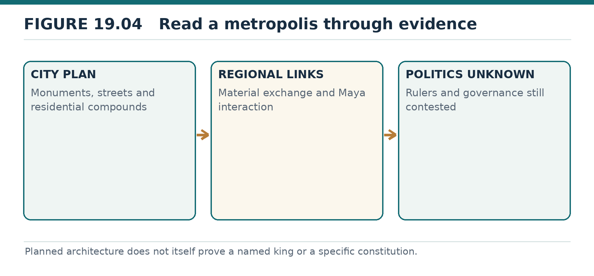

A traveler entering Teotihuacan in central Mexico during its flourishing centuries would encounter monumental platforms, residential compounds and an extraordinary organized landscape. The Avenue of the Dead, the Pyramids of the Sun and Moon and the complex associated with the Feathered Serpent formed part of a city whose planning followed shared spatial principles. Teotihuacan expanded particularly during the first centuries CE and had major regional influence before its central institutions declined in the sixth and seventh centuries. Its population has been estimated at high levels, but exact totals vary across studies and definitions of the urban zone.

Residential compounds and material finds point to a socially diverse city, with craft production and people connected to different regions. Political authority is harder to reconstruct than the stone monuments might imply. Unlike many Classic Maya centers, Teotihuacan has not given historians a securely understood line of named royal rulers. Some scholars have explored the possibilities of more collective arrangements, while others emphasize powerful elites and coercive institutions. Neither model should be presented as proven beyond debate.

Its influence reached beyond the Valley of Mexico. Connections with Maya cities are visible in material culture, architecture and episodes recorded in Maya inscriptions; the exact meanings of particular interactions remain debated. Teotihuacan's later disruption included burning in parts of its center and major demographic and political change. But 'the city burned' is not a complete causal theory. Internal conflict, environmental stress, political upheaval and changing networks have been investigated with different degrees of support. Nor was Teotihuacan the same city or polity as the much later Mexica Tenochtitlan.

<figure class="figure" id="figure-19-4">

<figcaption>Figure 19.4. Planned architecture does not itself prove a named king or a specific constitution. <a class="figure-anchor" href="#figure-19-4" aria-label="Link to this figure">#</a></figcaption>
</figure>
