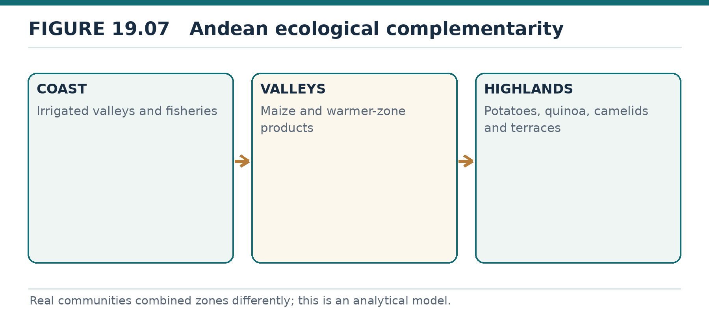

The Andes stretch along South America's western edge, creating dramatically different conditions over short distances. On the Pacific coast, rain is scarce in many valleys, but rivers descending from the mountains allow irrigation. Higher up, farmers developed practices suited to variable altitudes, frosts and steep terrain. The eastern slopes connect to cloud forests and Amazonian regions with another set of products. The phrase <em>vertical economy</em> describes one important Andean strategy: communities sought access, directly or through exchange, to productive zones at different elevations.

A household might depend on potatoes and camelids in uplands, maize in warmer valleys, and goods obtained by trade with lowland or coastal communities. But this was not a timeless formula applied identically across all Andean societies. Control of roads, irrigation, herds, crop storage and ritual centers could organize political power in different ways. Coastal fishing and intensive farming were particularly important in some regions. Andean historians must therefore work on multiple scales, from a local canal to a road system crossing thousands of kilometers.

The Andes also remind us that complex technologies need not resemble the Mediterranean or Chinese examples encountered in earlier chapters. Fine textiles could be repositories of status and knowledge; stone construction could withstand difficult terrain; and recordkeeping could operate through knotted cords. The question is not why these societies did not copy Eurasian institutions. The question is how they built effective systems from their own resources, experiences and political choices.

<figure class="figure" id="figure-19-7">

<figcaption>Figure 19.7. Real communities combined zones differently; this is an analytical model. <a class="figure-anchor" href="#figure-19-7" aria-label="Link to this figure">#</a></figcaption>
</figure>
