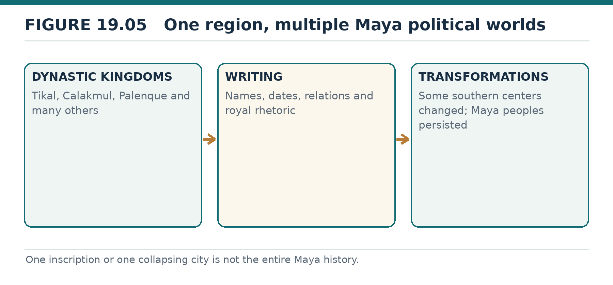

The Maya occupied a broad region that includes parts of southern Mexico, Guatemala, Belize, Honduras and El Salvador. Their history stretches across long periods and continues into the present through living Maya communities and languages. They were never uniformly ruled by one 'Maya Empire.' In the Classic period, roughly 250–900 CE as a conventional chronological frame, powerful kingdoms competed, negotiated marriages, formed alliances and staged rituals at centers such as Tikal, Calakmul, Palenque and Copán. Many other settlements ranged from hamlets to significant towns and city-states.

Royal monuments often recorded accession, warfare, ancestry and ceremonial occasions. This wealth of writing makes parts of Maya political history unusually vivid. But court texts favor dynasties and political performance. What happened in farms, kitchens, markets or smaller communities must be reconstructed with archaeology and environmental data. A city does not exist only in its palace square. Reservoirs, raised fields, terraces and other adaptations mattered in a region where water availability varied greatly across landscapes.

The word 'collapse' is easily abused in Maya history. Between the eighth and tenth centuries, many southern lowland centers lost rulers or suffered population decline, and monuments stopped being commissioned in familiar ways. Yet people did not vanish, nor did Maya civilization end. Important northern centers developed or persisted; communities continued across the region and survive today. Drought evidence, warfare, ecological pressures, political fragmentation and the cost of sustaining courts all figure in scholarly explanations. Their importance differed by location and time, so a single-cause story is inadequate.

<figure class="figure" id="figure-19-5">

<figcaption>Figure 19.5. One inscription or one collapsing city is not the entire Maya history. <a class="figure-anchor" href="#figure-19-5" aria-label="Link to this figure">#</a></figcaption>
</figure>
