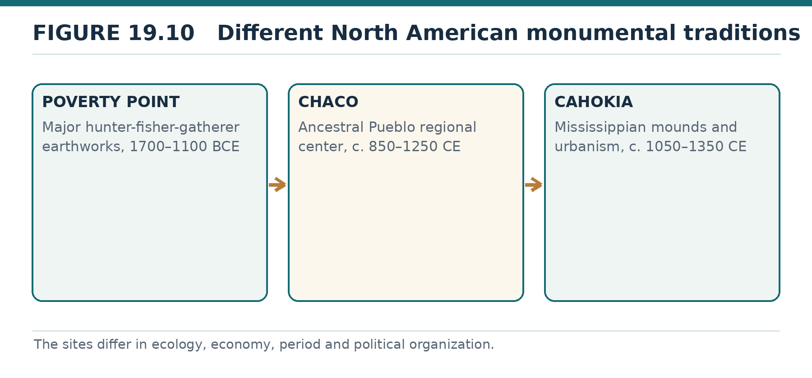

In eastern North America, monumental earthworks have a deep and varied history. The Poverty Point complex in present-day Louisiana, with its large ridges and mounds, was used between roughly 1700 and 1100 BCE. Its significance challenges the assumption that only large cereal-farming states could organize major monuments. Later societies in the Ohio Valley built extensive ceremonial earthworks, and communities across eastern North America developed different farming, trading and ritual traditions. These events were not episodes of a single culture simply changing its name.

By around 1050 CE, Cahokia, near the modern city of St. Louis, became a major center within the Mississippian world. Its monumental mounds, planned spaces and surrounding settlements indicate concentrated social power and regional links. UNESCO describes a large population at its peak—commonly estimated in a broad range rather than counted through a census. Corn agriculture supported many Mississippian societies, but the relations among politics, ritual authority, craft production and regional exchange remain open to study. Monks Mound is a feat of coordinated construction, yet we cannot read a surviving royal chronicle identifying all its builders.

Cahokia's later political contraction was not the extinction of its people or a sudden end to Indigenous civilization in the Mississippi Valley. Populations, settlements and traditions changed; later Native nations maintained complex political and cultural lives. The term 'mound builders' was once misused by writers who denied Indigenous peoples credit for ancient constructions. Archaeological evidence and Indigenous histories firmly establish these earthworks as Native American achievements. Here the history of archaeology itself teaches a lesson about prejudice affecting interpretation.

<figure class="figure" id="figure-19-10">

<figcaption>Figure 19.10. The sites differ in ecology, economy, period and political organization. <a class="figure-anchor" href="#figure-19-10" aria-label="Link to this figure">#</a></figcaption>
</figure>
