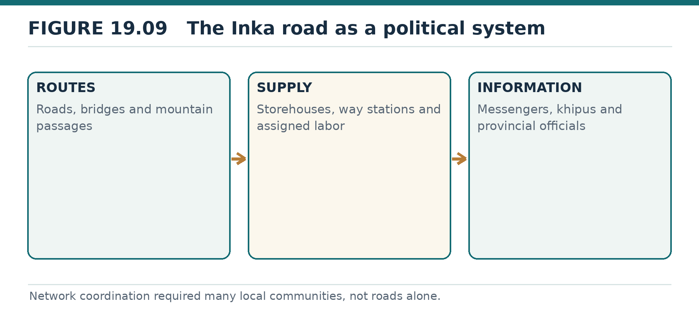

One of Tawantinsuyu's most remarkable achievements was the Qhapaq Ñan, an extensive road network with sections built long before the Inka expansion. Routes crossed high mountain passes, connected valleys and administrative centers, and required bridges, way stations and constant maintenance. UNESCO describes a system of more than 30,000 kilometers, though estimates depend on how routes and associated segments are counted. These roads enabled official messengers, movement of goods and troops, supervision and ceremonial journeys; they were not a paved highway system for wheeled carts.

A road did not function in isolation. State storehouses held supplies; relay messengers could carry information; local communities provided labor and maintenance; and officials coordinated transfers. Think of the system as a chain of relationships whose failure at any one point could disrupt activity elsewhere. A commanding ruler in Cusco was powerful only to the extent that administrators, carriers, farmers and local leaders kept those links working. <strong>Infrastructure is a form of political capacity</strong>, not simply a technical accomplishment.

Consider a teaching calculation. If a runner could relay a message along 25 kilometers of route each hour in an idealized system of continuous handoffs, 300 kilometers would require 12 hours. Real travel times depended on terrain, elevation, staffing, rest, weather and the kind of message. We are not deriving a historical Inka dispatch time from an invented constant. The calculation illustrates the importance of clear assumptions when evaluating claims about astonishing communication speeds.

<figure class="figure" id="figure-19-9">

<figcaption>Figure 19.9. Network coordination required many local communities, not roads alone. <a class="figure-anchor" href="#figure-19-9" aria-label="Link to this figure">#</a></figcaption>
</figure>
