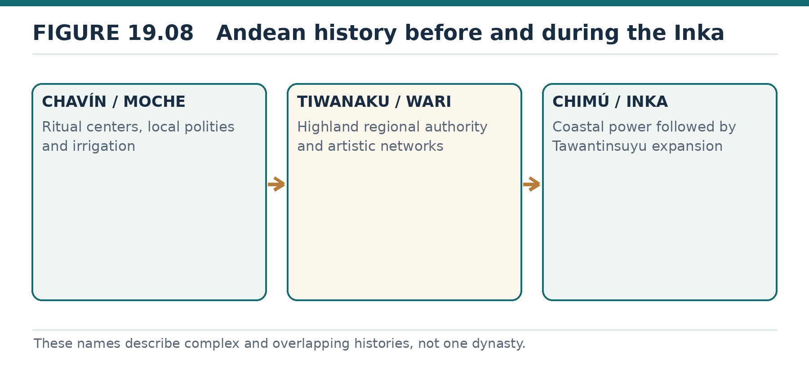

Around the Lake Titicaca basin, Tiwanaku developed an influential ceremonial and political center during the first millennium CE. Monumental architecture, stone sculpture and a sophisticated high-altitude agricultural landscape have made it central to Andean history. Farther north in the central highlands, Wari power and cultural styles spread through extensive territories, with planned settlements, textiles and ceramics offering important clues. These polities interacted with other communities, but their forms of expansion and government were not necessarily identical.

Both underwent major transformations around the end of the first millennium and thereafter. Scholars examine environmental pressures, political competition, reorganization and other local causes without turning 'collapse' into the disappearance of entire populations. After these transformations, strong regional kingdoms and cities emerged. On Peru's northern coast the Chimú state developed its capital at Chan Chan and organized large irrigated territories. Its engineering and administration preceded the Inka conquest of the area, showing how later empires inherited, adapted and sometimes appropriated earlier systems.

This sequence is essential for avoiding the mistaken impression that the Inka invented Andean complexity from nothing. Roads, irrigation knowledge, administrative practices, visual traditions and political institutions had long histories. Equally, the Inka did not merely inherit an unchanged package. They reorganized many existing resources into an expanding imperial framework that both depended on and constrained local communities. A chart of successive names should never erase the people living through these changes.

<figure class="figure" id="figure-19-8">

<figcaption>Figure 19.8. These names describe complex and overlapping histories, not one dynasty. <a class="figure-anchor" href="#figure-19-8" aria-label="Link to this figure">#</a></figcaption>
</figure>
