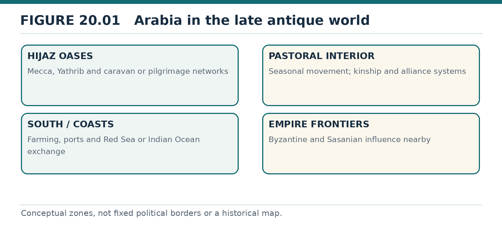

The Arabian Peninsula had no single economy or political system. In the western Hijaz, Mecca and Yathrib—later known as Medina—were associated with pilgrimage, regional commerce and oasis life. Southern Arabia had long-established agricultural and commercial traditions; coastal districts linked the peninsula to the Red Sea and Indian Ocean. In many other areas, mobile pastoralism and tribal or kinship obligations helped people manage scarce pasture and water. Kinship did not mean that every relationship was biological. Alliances, patronage, client relationships and negotiated protection also mattered.

Geography helps explain the peninsula's diversity. Drought-prone interiors could support seasonal movement; oases concentrated farming and exchange; maritime routes connected southern ports to East Africa and South Asia. It is misleading to describe all inhabitants of Arabia as desert nomads or to imagine a single tribal code governing everyone. Arabian communities also interacted with the wider <strong>late antique</strong> world: the eastern Roman, or Byzantine, Empire to the northwest and the Sasanian Persian Empire to the northeast. Their rivalries reached into Arabia through diplomatic clients, frontier kingdoms and competing religious and commercial connections.

Arabia also contained varied religious traditions. Local cults and sacred places coexisted with Jewish and Christian communities, along with individuals and groups drawn to monotheism. Mecca's Kaaba was an important sanctuary in later Islamic tradition, and the Qur'an repeatedly addresses an audience familiar with Abrahamic stories and debates about divine authority. To say Islam emerged within this world is <strong>not</strong> to reduce its meaning to surrounding influences. Historians describe the social setting and available sources; believers also understand Muhammad's revelation as a divine event. These are different kinds of explanation, and a careful book distinguishes them rather than forcing one to impersonate the other.

<figure class="figure" id="figure-20-1">

<figcaption>Figure 20.1. Conceptual zones, not fixed political borders or a historical map. <a class="figure-anchor" href="#figure-20-1" aria-label="Link to this figure">#</a></figcaption>
</figure>
