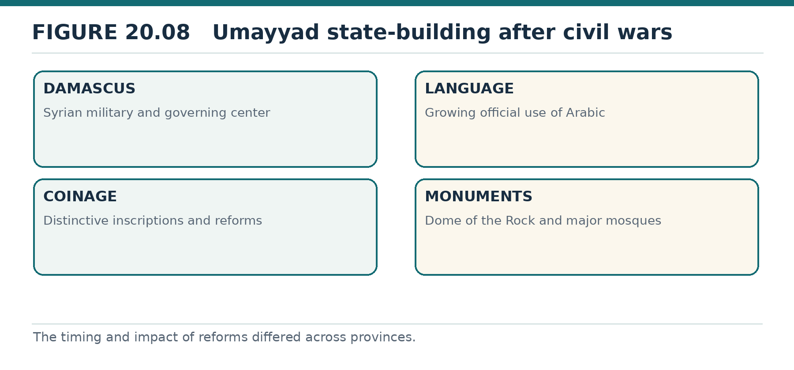

Under <strong>Abd al-Malik (685–705)</strong> and his successors, the Umayyad state developed recognizably Islamic imperial forms. Arabic took an increasingly official role in central administration, although replacement of older bureaucratic languages occurred at different rates across provinces. Coinage came to use distinctive inscriptions and designs rather than simply reproducing Byzantine or Sasanian patterns. Monumental building helped proclaim the dynasty's religious and political claims. The <strong>Dome of the Rock</strong> in Jerusalem, completed around <strong>691–692</strong>, is especially important: its inscriptions, architecture and location communicate messages about monotheism and authority within a city sacred to multiple religious communities.

The state also built or enlarged mosques, maintained roads and supported urban institutions. Umayyad art drew upon Byzantine, Sasanian and local traditions while developing new formal solutions. The <strong>Great Mosque of Damascus</strong>, built under <strong>al-Walid I</strong> in the early eighth century, demonstrates the scale of imperial religious architecture. Its mosaics and urban setting reveal exchange as well as political ambition. A ruler could claim to govern an expanding Muslim polity while employing craftsmen and administrative techniques shaped by earlier worlds.

Here a familiar distinction matters: <strong>Arabization</strong> is the growing use of Arabic language and cultural forms; <strong>Islamization</strong> is the spread of Islam as religious identity and practice. They often interacted, but they were not the same process. An Arabic-speaking Christian did not become a Muslim simply because an office used Arabic, and a Persian-speaking Muslim did not need to abandon Persian culture to belong to the Muslim community. Across centuries, these processes produced a world more culturally diverse than the category “Arab Empire” might suggest.

<figure class="figure" id="figure-20-8">

<figcaption>Figure 20.8. The timing and impact of reforms differed across provinces. <a class="figure-anchor" href="#figure-20-8" aria-label="Link to this figure">#</a></figcaption>
</figure>
