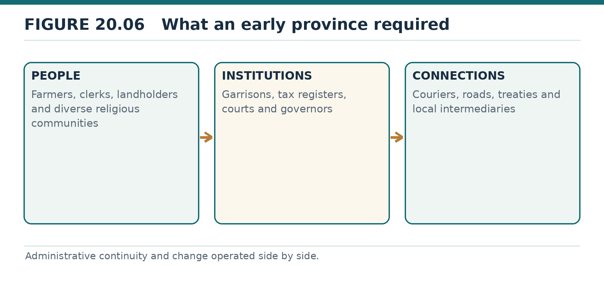

Conquest is an event; government is a continuous task. Early Muslim rulers needed to feed soldiers, settle disputes, finance military expeditions and maintain agricultural production. Garrison towns such as <strong>Kufa</strong> and <strong>Basra</strong> in Iraq, and <strong>Fustat</strong> in Egypt, became important centers of military, administrative and later intellectual life. They were not merely camps. Over time, they developed neighborhoods, markets, mosques, political factions and scholarly institutions. Their growth reshaped local society even where rural farming patterns remained much older.

Much administration continued to rely on officials and procedures inherited from the Byzantines and Sasanians. Greek, Coptic, Persian and other languages remained significant in local records, while Arabic became increasingly prominent. Tax arrangements varied by time, region and legal category. Later jurists distinguished <strong>kharaj</strong>, commonly associated with land revenue, from <strong>jizya</strong>, commonly associated with a poll levy on eligible non-Muslim subjects; applying fully systematized later definitions without qualification to every seventh-century district would be an anachronism. What mattered to taxpayers was often the actual assessment, collection method and possibility of appeal.

Subjects were not interchangeable. A Christian monastery, a Jewish community, a Zoroastrian landholder, a new Muslim convert and an Arabian military settler could experience the ruling order in different ways. The institution known as <strong>dhimma</strong> became a framework of protected but unequal status for recognized non-Muslim communities under many Muslim governments. Details varied. Sometimes protection offered stability relative to violent wartime conditions; at other times discrimination, heavier burdens or coercive pressure were real. The historical obligation is neither to romanticize harmonious coexistence nor to deny the coexistence that took place.

<figure class="figure" id="figure-20-6">

<figcaption>Figure 20.6. Administrative continuity and change operated side by side. <a class="figure-anchor" href="#figure-20-6" aria-label="Link to this figure">#</a></figcaption>
</figure>
