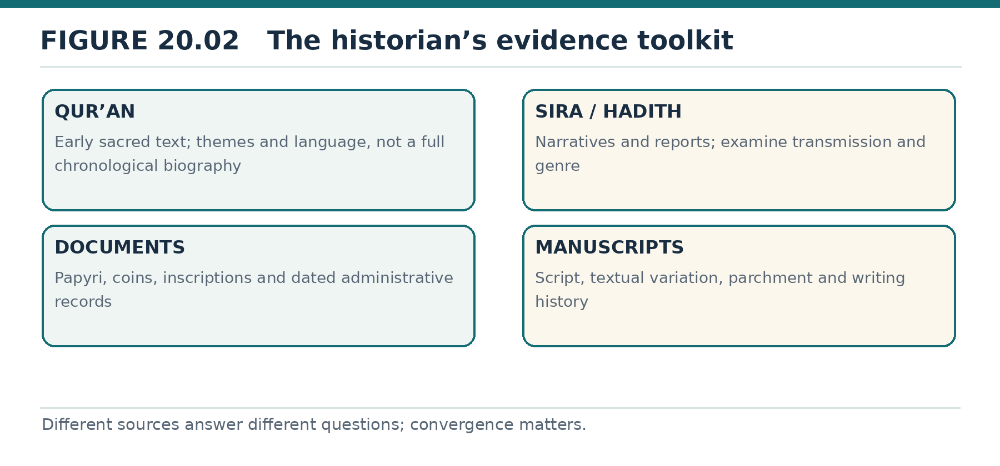

The seventh century is comparatively close to us when measured against ancient Mesopotamia, yet reconstructing early Islamic history still presents serious source problems. The <strong>Qur'an</strong> is the central sacred text of Islam and a vital early witness to the movement's religious ideas and vocabulary. It is not arranged as a chronological biography. Detailed narratives of Muhammad's life appear in later <strong>sira</strong> literature; reports of his sayings and practices appear in <strong>hadith</strong> collections that were systematically gathered and evaluated over generations. Early historical works, administrative papyri, inscriptions, coins, architecture and surviving Qur'anic manuscripts provide other kinds of evidence.

Each source answers a different question. A Qur'anic passage can establish the language and concerns of the text but may not independently identify the precise date of an episode. A later biography can preserve older reports while also reflecting the interests and conventions of its transmission. A coin can establish which ruler or religious formula a government officially displayed, but not the inner convictions of everyone who used it. A dated inscription fixes certain names and claims, while leaving a larger political narrative incomplete. These are reasons to investigate sources, not reasons to dismiss the past as unknowable.

Muslim scholars developed sophisticated methods for assessing transmitted reports, including scrutiny of chains of transmission and narrators. Modern historians also examine genre, dating, corroboration and possible retrospective shaping. The two methods overlap in some concerns but are not identical. A respectful historical chapter can state, for example, <strong>“Islamic tradition relates...”</strong> where details primarily survive in later accounts, and <strong>“the inscription records...”</strong> when a contemporary object directly attests to a claim. Neither phrase is a sneer. Precision protects both scholarly honesty and religious discussion.

<figure class="figure" id="figure-20-2">

<figcaption>Figure 20.2. Different sources answer different questions; convergence matters. <a class="figure-anchor" href="#figure-20-2" aria-label="Link to this figure">#</a></figcaption>
</figure>
