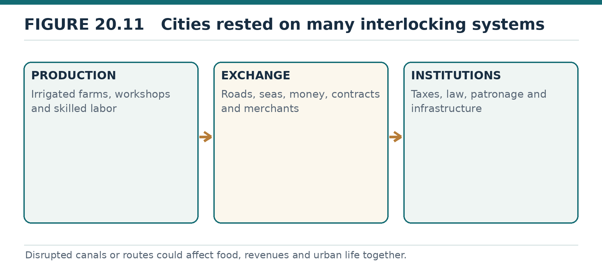

Baghdad's prosperity depended on production far beyond Baghdad. Irrigated agriculture in Iraq and Egypt, textile manufacture, metalwork, ceramics, glass, paper production, livestock, precious metals and long-distance trade connected many provinces and neighboring societies. Merchants and travelers crossed the Mediterranean, the Red Sea, the Persian Gulf, Central Asian caravan routes and the Indian Ocean. Money, credit arrangements, written orders and trusted intermediaries helped lower some costs of exchange, though routes were dangerous and transaction practices varied.

Do not imagine a frictionless free-trade zone. Governments imposed taxes, tolls and monopolies; ports and roads could be insecure; rival powers fought over strategic places; slavery and coerced labor formed part of some economic systems. Farmers bore irrigation and revenue burdens, and urban fortunes could disappear through war or political confiscation. Economic growth in one region could coexist with severe inequalities elsewhere. Nevertheless, the scale of movement was extraordinary, and goods carried knowledge: paper, scientific texts, crops, artistic techniques, religious works and commercial practices all traveled.

A systems perspective helps. Merchants needed predictable contracts and transport; states needed taxes and supplies; scholars needed patrons and books; workshops needed skilled labor and customers. These systems reinforced one another when conditions were favorable. They could also fail together. A damaged canal reduces agricultural output, which reduces urban supplies and taxes, which in turn undermines canal maintenance. Chapter 7's feedback loops are not abstract; they help explain why some prosperous regions became vulnerable despite possessing advanced institutions.

<figure class="figure" id="figure-20-11">

<figcaption>Figure 20.11. Disrupted canals or routes could affect food, revenues and urban life together. <a class="figure-anchor" href="#figure-20-11" aria-label="Link to this figure">#</a></figcaption>
</figure>
