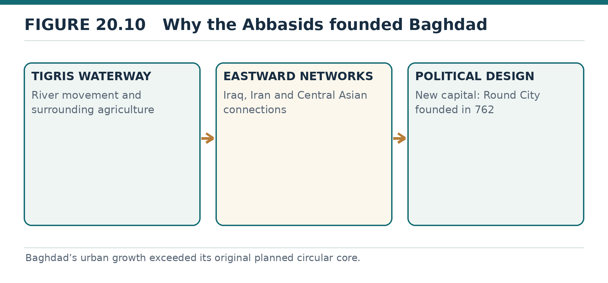

In <strong>750</strong>, the Umayyad caliphate in its Syrian-centered form was overthrown by the <strong>Abbasid</strong> movement, which claimed descent from al-Abbas, an uncle of Muhammad. The revolution combined religious claims with regional, military and social coalitions. The Abbasids moved the political center eastward and increasingly drew upon Iranian, Iraqi and other administrative traditions. A surviving Umayyad prince established a ruling dynasty in <strong>al-Andalus</strong> from 756, showing that a revolution in one imperial center did not end all Umayyad power everywhere.

In <strong>762</strong>, the Abbasid caliph <strong>al-Mansur</strong> founded <strong>Baghdad</strong> beside the Tigris, near the older centers of Mesopotamian and Sasanian rule. The planned <strong>Round City</strong> symbolized an ambition to build a new governing center, although the later city grew far beyond that original plan. Baghdad's location mattered. It connected river routes, agricultural districts and caravan networks reaching toward Iran, Syria, the Gulf and Central Asia. Scholars, traders, craftsmen, officials and religious figures moved through an urban environment that drew resources from many regions.

Abbasid rule should not be treated as a permanent golden age in which politics ceased to matter. Court rivalries, provincial resistance, military expenditure and succession disputes continued. Over time, provincial dynasties acquired greater autonomy; later Abbasid caliphs sometimes retained immense religious prestige while possessing less direct military authority. The Abbasid family ruled as caliphs in Baghdad until <strong>1258</strong>, but the political and social world of the ninth century cannot simply be projected unchanged across five centuries.

<figure class="figure" id="figure-20-10">

<figcaption>Figure 20.10. Baghdad’s urban growth exceeded its original planned circular core. <a class="figure-anchor" href="#figure-20-10" aria-label="Link to this figure">#</a></figcaption>
</figure>
