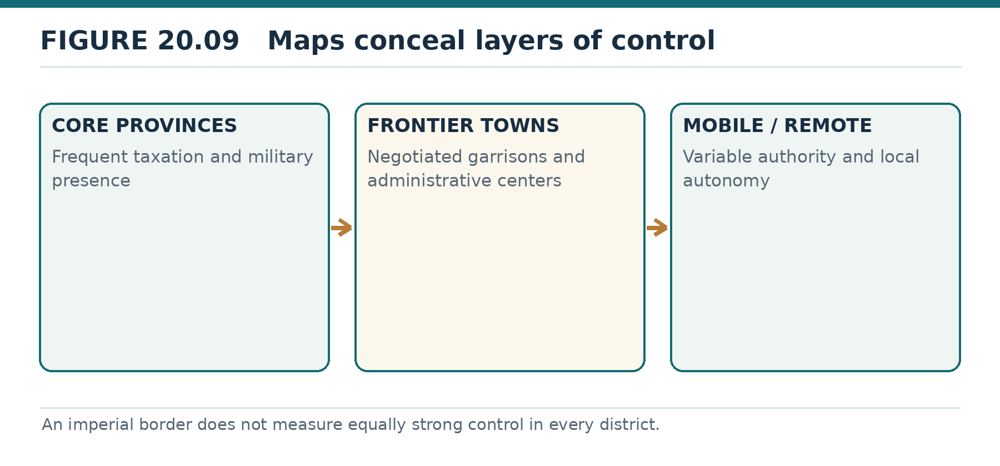

Under Umayyad rule, Muslim-led armies extended authority across <strong>North Africa</strong>, entered the <strong>Iberian Peninsula in 711</strong>, and established power in regions reaching toward <strong>Transoxiana</strong> and <strong>Sindh</strong>. These expansions were not a continuous, frictionless wave. In North Africa, Amazigh communities resisted, negotiated, converted and increasingly participated in military and political life. In Iberia, the overthrow of the Visigothic ruling order involved Arab and Amazigh forces, local political divisions and changing alliances. Central Asian cities and frontier societies posed their own military and diplomatic challenges.

A single line on a textbook map is therefore dangerously clean. It hides garrisons, tributary agreements, rebellions, mountain routes and local rulers who retained partial autonomy. Conquest also did not produce immediate universal conversion. Christian communities endured in Iberia, and other traditions persisted across North Africa and Asia. The balance changed over generations through institutions, taxation, trade, intermarriage, patronage and religious conviction, not merely by being listed inside an imperial border.

Nor did the empire control every land between distant points with equal intensity. Frontier castles, tax-collecting towns, independent mountain communities and mobile populations experienced rule differently. When discussing the speed of expansion, a careful historian pairs the empire's broad territorial reach with a map of <strong>administrative density</strong>: the ability to command resources, enforce law and receive accurate information becomes weaker or more negotiated at distance. That is a problem faced by all large empires, from Persia and Rome to the caliphates.

<figure class="figure" id="figure-20-9">

<figcaption>Figure 20.9. An imperial border does not measure equally strong control in every district. <a class="figure-anchor" href="#figure-20-9" aria-label="Link to this figure">#</a></figcaption>
</figure>
