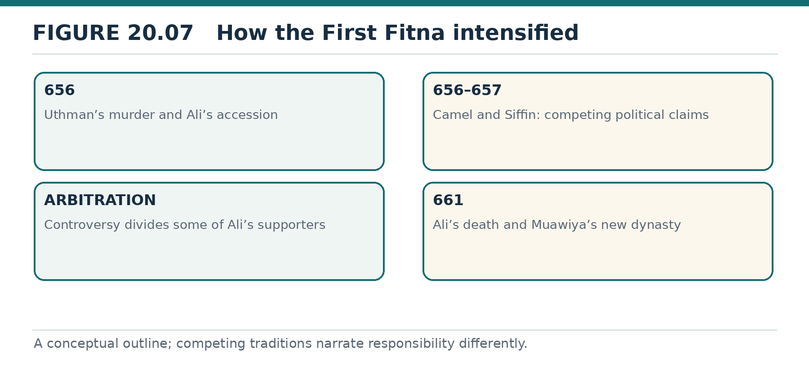

Ali ibn Abi Talib became caliph in <strong>656</strong> amid deep division. He was Muhammad's cousin and son-in-law, a central figure in the Prophet's family, and a respected early believer. A struggle over political legitimacy, accountability for Uthman's murder and control of the provinces led to the <strong>First Fitna</strong>, or first major civil war. The Battle of the Camel in 656 and the confrontation at <strong>Siffin in 657</strong> became pivotal episodes. The precise motives of individuals and groups are represented differently in later accounts; reducing the conflict to a morality play of pure heroes and villains would obstruct understanding.

At Siffin, conflict between Ali's supporters and forces loyal to <strong>Muawiya</strong>, governor of Syria and an Umayyad relative of Uthman, led to a controversial attempt at arbitration. Some former supporters of Ali opposed the process and developed into groups later remembered as <strong>Kharijites</strong>. Kharijite movements themselves were varied, and later polemical descriptions can obscure that variation. Ali was assassinated in <strong>661</strong> by an opponent traditionally associated with the Kharijites. These events show how quickly a disagreement about succession could become a dispute about law, justice, religious authority and the use of force.

For a student of systems thinking, the war offers a painful feedback pattern. A death created demands for justice; rival authorities distrusted one another's ability to investigate impartially; armed mobilization deepened suspicions; attempts at compromise alienated some supporters; violence created new grievances. That explanatory model does not erase responsibility or equate all actors. It shows why a conflict that everyone might describe as defending communal unity could fracture it further. The long-term impact was immense: competing ideas of the legitimate leader were now attached to remembered events, families and martyrs.

<figure class="figure" id="figure-20-7">

<figcaption>Figure 20.7. A conceptual outline; competing traditions narrate responsibility differently. <a class="figure-anchor" href="#figure-20-7" aria-label="Link to this figure">#</a></figcaption>
</figure>
