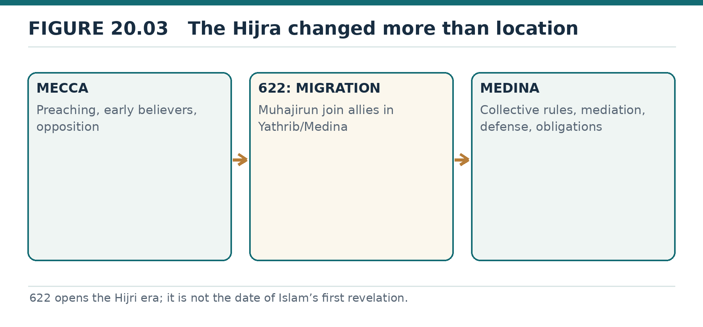

The decisive change came with the <strong>Hijra</strong>—Muhammad's migration with followers from Mecca to Yathrib in 622 CE. In Muslim chronology, this event marks the beginning of the Hijri calendar; that does not mean the first revelation occurred in 622. The city came to be known as Medina, “the City,” and Muhammad's role expanded from preacher to mediator and political leader among groups that had experienced conflict. The followers who migrated from Mecca became known as <strong>muhajirun</strong>, while those in Medina who supported them were called <strong>ansar</strong>. These categories carried a powerful memory of sacrifice and solidarity.

The document commonly called the <strong>Constitution of Medina</strong> is particularly important. Versions preserved through later texts describe agreements concerning community membership, mutual assistance, dispute settlement and relations among Muslim groups and Jewish tribes. Scholars debate whether the surviving wording represents one document or related agreements composed at different moments. Calling it the first modern constitution would impose modern constitutional ideas on a very different political world. Its real significance lies in efforts to organize obligations across kinship divisions and to create collective mechanisms for security and arbitration.

The Hijra teaches us a wider principle about state formation. A common belief can help people cooperate, but a functioning community must also arrange food, mutual protection, conflict resolution, leadership and obligations toward outsiders. In Medina, religious commitment and practical politics became inseparable. The early <strong>ummah</strong>, or community, was not merely a set of private believers; it acquired forms of collective life. Yet the precise composition and political status of all Medina's groups changed over time, and later accounts should not be flattened into a picture of permanent harmony or permanent hostility.

<figure class="figure" id="figure-20-3">

<figcaption>Figure 20.3. 622 opens the Hijri era; it is not the date of Islam’s first revelation. <a class="figure-anchor" href="#figure-20-3" aria-label="Link to this figure">#</a></figcaption>
</figure>
