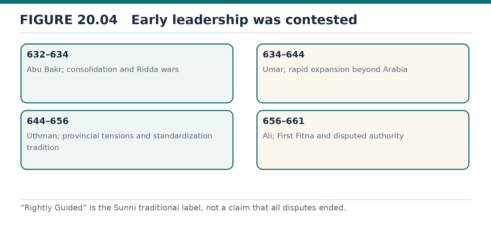

After Muhammad's death, Abu Bakr became the first caliph according to the historical sequence recognized in the major chronicles. <strong>Caliph</strong> derives from an Arabic term meaning successor or deputy; it came to designate leadership of the Muslim community, though the office's exact authority changed profoundly over time. The first four caliphs—Abu Bakr, Umar, Uthman and Ali—are collectively known in Sunni tradition as the <strong>Rashidun</strong>, or “Rightly Guided.” Shia Muslims place special emphasis on Ali's rightful authority and the leadership of the Prophet's family, and do not interpret the whole succession in the same way.

These differences cannot fairly be reduced to an argument about who was popular. They involve competing understandings of Muhammad's statements, communal consultation, kinship, religious authority, justice and the character of leadership. Sunni historical narratives often emphasize the legitimacy of the early community's selection or acceptance of caliphs; Shia traditions emphasize the spiritual and political significance of Ali and the Prophet's household (<strong>ahl al-bayt</strong>). The fully developed doctrinal divisions took shape over time; they should not be imagined as two finished denominations standing opposite one another on the very first day after 632.

Nor should the debate erase what the early community faced immediately: disparate Arabian groups had different kinds of commitments. After Muhammad's death, some rejected the authority of Medina, resisted payments or followed alternative prophetic figures. Abu Bakr's campaigns, conventionally termed the <strong>Ridda wars</strong>, sought to consolidate the new polity. Whether every opponent understood the conflict as religious apostasy is not the same question as how victorious Muslim chronicles classified the rebellions. This is a useful example of the difference between a political actor's label and a historian's full explanation.

<figure class="figure" id="figure-20-4">

<figcaption>Figure 20.4. “Rightly Guided” is the Sunni traditional label, not a claim that all disputes ended. <a class="figure-anchor" href="#figure-20-4" aria-label="Link to this figure">#</a></figcaption>
</figure>
