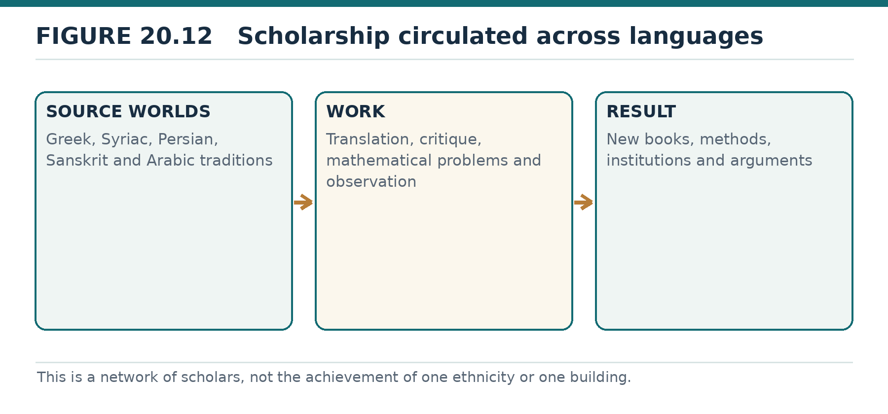

The Abbasid court and surrounding urban societies supported the movement of books, scholars and technical knowledge across languages. Texts associated with Greek mathematics, medicine and philosophy were translated into Arabic, often through the work of <strong>Christian Syriac-speaking scholars</strong> and others trained in multiple intellectual traditions. Persian, Sanskrit and older Mesopotamian learning also contributed to the broader scholarly environment. The term <strong>translation movement</strong> is useful, but the picture of a single institution magically preserving every ancient text is too simple. Translation involved many patrons, libraries, workshops and scholarly circles.

The name <strong>Bayt al-Hikma</strong>, or “House of Wisdom,” is associated with Abbasid Baghdad; historians disagree about the precise structure and functions of the institution at particular times. It should not be imagined as a modern university with a fixed curriculum. Intellectual activity took place in courts, private libraries, observatories, mosques, hospitals and households, with varying levels of formal organization. Nor did scholars merely copy. They criticized, reorganized, solved problems and developed new approaches. <strong>Al-Khwarizmi</strong>, active in the ninth century, wrote influential work on algebra and calculation; the English word “algorithm” derives from a Latinized form of his name. Such developments drew on and transformed earlier mathematical traditions.

The wider history of sciences in Muslim societies includes figures from many centuries: the physician <strong>al-Razi</strong>, the philosopher and physician <strong>Ibn Sina</strong>, and the optical investigator <strong>Ibn al-Haytham</strong> are well-known examples, though they did not all belong to the same generation or city. A fair account credits scholars of different faiths and languages, understands knowledge as cumulative, and avoids claiming that every invention in a large region was created by one undifferentiated “civilization.” In the Abbasid world, scholarly achievement was part of a complex social infrastructure of paper, booksellers, patronage, debate, observation and practical demand.

<figure class="figure" id="figure-20-12">

<figcaption>Figure 20.12. This is a network of scholars, not the achievement of one ethnicity or one building. <a class="figure-anchor" href="#figure-20-12" aria-label="Link to this figure">#</a></figcaption>
</figure>
