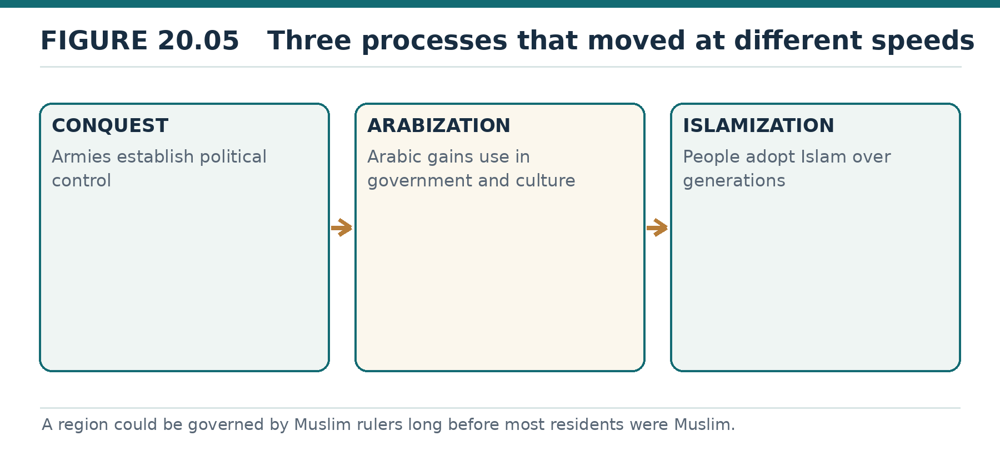

During the caliphate of <strong>Umar (634–644)</strong>, Muslim armies expanded far beyond the peninsula. They defeated Byzantine forces in Syria and Palestine; Egypt came under Muslim rule; and the Sasanian monarchy suffered decisive defeats, with Muslim control expanding through Iraq and Iran over subsequent years. The Battle of <strong>Yarmuk (636)</strong> and fighting around <strong>al-Qadisiyya</strong> are prominent in traditional military narratives, although details and exact dates in some conquest accounts remain debated. The conquest of Alexandria and other Egyptian centers involved military campaigns as well as negotiated relationships with local authorities.

The speed of expansion poses an important causal puzzle. Religion and a shared political framework helped motivate some participants, but they were not the only causes. Leadership, military mobility, coalition building, access to booty and revenue, rival powers' exhaustion, and local accommodations all mattered. The soldiers also inherited roads, farming regions, fiscal systems and established administrative expertise. A simple statement such as “the armies won because they were united” cannot explain why some campaigns succeeded and others slowed or failed.

The new rulers did not initially require every subject to convert to Islam. Most people in Syria, Egypt, Iraq and Iran remained members of older religious communities for significant periods. Some towns saw garrison settlements and shifting land taxes; other places retained institutions under negotiated conditions. To understand early Islam's geographical growth, distinguish <strong>territorial conquest</strong> from <strong>individual religious conversion</strong>. The former could take years; the latter often unfolded across centuries and differed by social class and region.

<figure class="figure" id="figure-20-5">

<figcaption>Figure 20.5. A region could be governed by Muslim rulers long before most residents were Muslim. <a class="figure-anchor" href="#figure-20-5" aria-label="Link to this figure">#</a></figcaption>
</figure>
