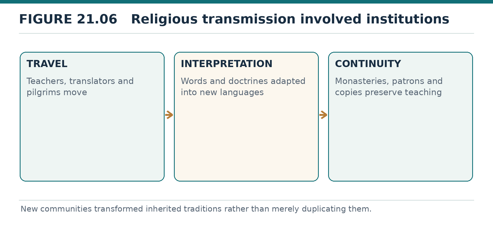

Buddhism began in South Asia centuries before our period, but its circulation through Central Asia and East Asia intensified interactions among monasteries, courts and trading communities. Routes through the Tarim Basin connected translators and pilgrims to traditions in India and Central Asia. Buddhist religious complexes, including the caves of <strong>Mogao</strong> near Dunhuang, contain images and manuscripts that illuminate how teachings were adapted and patronized. The spectacular ruins of Bamiyan in Afghanistan similarly testify to the scale of Buddhist artistic and religious life along routes connecting regions.

Travelers such as the Chinese monks <strong>Faxian</strong> (early fifth century) and <strong>Xuanzang</strong> (seventh century) journeyed toward South Asia in search of learning and texts. Their accounts are valuable because they recorded travel conditions, political landscapes and religious communities. But a pilgrim's purpose influences what he observes. He may discuss monasteries in more detail than village agriculture or the lives of women. Reading his words alongside inscriptions and archaeology produces a fuller picture.

The transmission of Buddhism also moved in new directions: Chinese, Korean and Japanese courts and communities developed distinctive religious cultures rather than making identical copies. Monks translated scriptures, rulers sponsored temples, and local believers brought different ritual needs. Religious exchange required <strong>institutions that preserved learning over generations</strong>, not only people traveling a route once. That institutional role is a bridge to the history of universities, libraries and scholarly networks in later chapters.

<figure class="figure" id="figure-21-6">

<figcaption>Figure 21.6. New communities transformed inherited traditions rather than merely duplicating them. <a class="figure-anchor" href="#figure-21-6" aria-label="Link to this figure">#</a></figcaption>
</figure>
