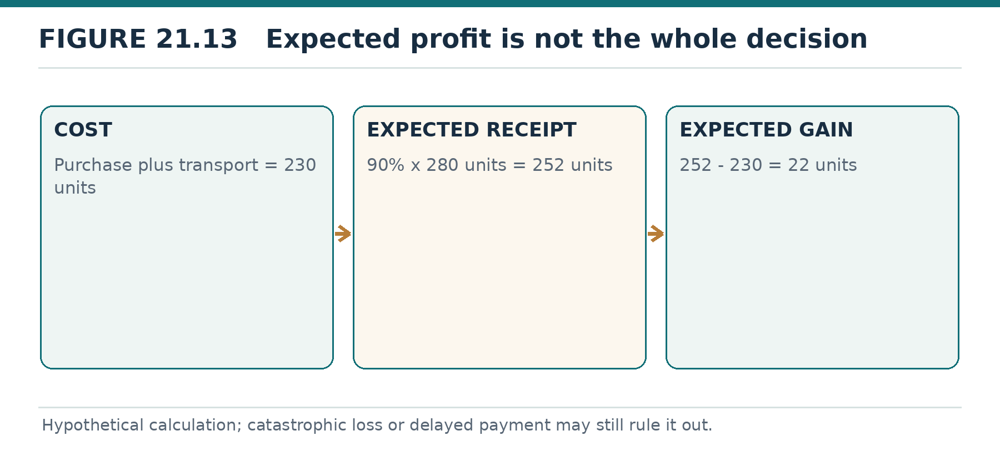

A long-distance merchant faced at least four difficulties: information about prices, safety of transport, reliable measures and payment, and the enforcement of agreements. Brokers, letters of credit in some commercial systems, partnerships, witnesses and repeated dealings helped solve these problems. No one method operated everywhere. A merchant could also depend on a local ruler's protections, legal institutions and customs arrangements. A guarantee that worked in one port might carry no authority in another town.

Consider a hypothetical shipment worth 200 accounting units when purchased. Transport, animal hire and tolls add 30 units. The merchant believes there is a 10% chance the entire shipment will be lost and, if it arrives, a sale price of 280 units. A simple expected gross receipt is 0.90 × 280 = 252; subtracting the 230 units paid produces an expected gain of <strong>22 units</strong>, before other costs. This is a teaching model, not a historical profit rate. The merchant might still reject the trade because losing 230 units could bankrupt the household; expected value is not the whole of risk management.

Such calculations help explain why traders demanded margins, varied routes, pooled capital and valued protection. Taxes could fund roads or defend towns, yet excessive tolls could divert trade. Protection might come with political dependence. Trust was crucial, but trade was not an apolitical force that naturally dissolved conflict. It operated inside struggles over authority and advantage.

<figure class="figure" id="figure-21-13">

<figcaption>Figure 21.13. Hypothetical calculation; catastrophic loss or delayed payment may still rule it out. <a class="figure-anchor" href="#figure-21-13" aria-label="Link to this figure">#</a></figcaption>
</figure>
