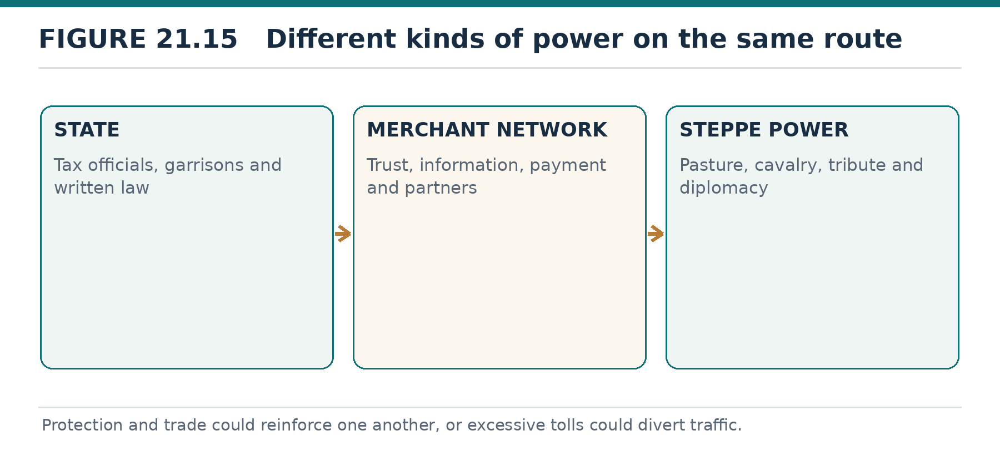

A Tang court official, a Sogdian merchant family and a steppe ruler may all appear in the same history of the Silk Roads, yet their power came from different mechanisms. The official might issue state documents, mobilize taxes or command a garrison. The merchant might connect people who trusted a commercial reputation across cities. The steppe ruler might control mounted forces, seasonal routes and access to political alliances. None was unlimited. A written order cannot make water flow through a broken canal; reputation cannot stop every raid; cavalry cannot permanently govern a city without arrangements for supply and administration.

These powers could cooperate. A state provided policing, a merchant financed exchange, and a mobile community supplied transport and horses. They could also conflict when taxes, tribute, tolls or security demands became excessive. Here Chapter 7's systems framework becomes concrete: every participant's choice changed the incentives of others. Protection might attract trade, which produced taxes, which funded more protection—a potentially reinforcing cycle. But an aggressive ruler might demand ever higher tolls, encouraging merchants to choose alternate routes and ultimately reducing revenue.

Understanding <strong>institutions</strong>, not simply exotic goods, makes the Silk Roads an explanation of history rather than a museum display. The achievement of medieval Eurasia was not global unity. It was a wide set of changing arrangements that made surprising connections possible without eliminating local diversity, distance or political conflict.

<figure class="figure" id="figure-21-15">

<figcaption>Figure 21.15. Protection and trade could reinforce one another, or excessive tolls could divert traffic. <a class="figure-anchor" href="#figure-21-15" aria-label="Link to this figure">#</a></figcaption>
</figure>
