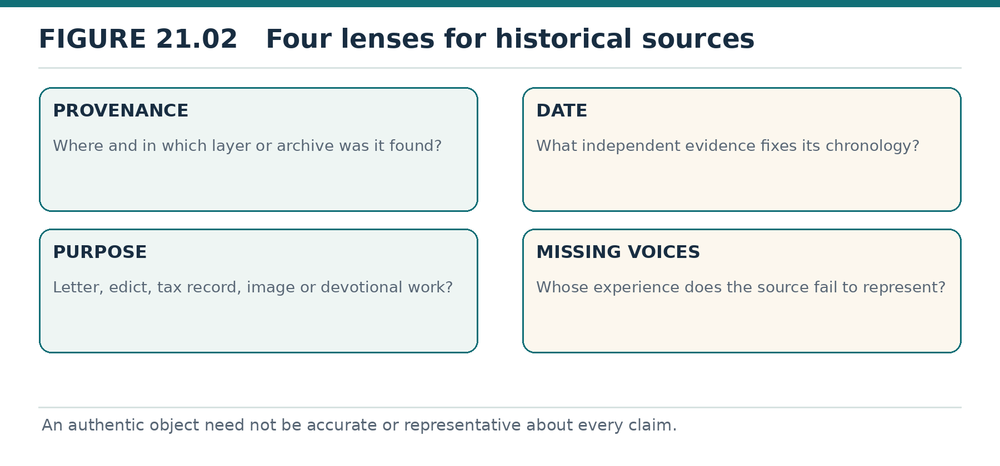

A history of continental exchange demands different evidence from a history of one kingdom. Archaeologists examine roadbeds, waterworks, ruins of inns, coins, ceramics, textiles, shipwrecks and even residues in containers. Philologists read documents in languages ranging from Chinese and Sogdian to Tibetan, Sanskrit, Arabic and Greek. Art historians investigate style and manufacturing technique. Environmental researchers reconstruct changes in rivers, vegetation and climate. No single archive provides an unbiased panorama.

Dunhuang in northwestern China is unusually important because manuscripts survived in the dry environment, including materials found in the famous <em>Library Cave</em> at Mogao. They illuminate religion, administration, local contracts, social life, language contact and the reuse of paper. But their survival is exceptional. We must resist treating Dunhuang's unusually rich record as proof that every town along the routes looked exactly like Dunhuang. Other communities wrote on materials that disintegrated or maintained traditions orally; their pasts may be harder to recover.

A useful method is to ask four questions. <strong>Provenance:</strong> where and in what context was the object found? <strong>Date:</strong> what independently supports its chronology? <strong>Function:</strong> was it a household letter, religious image, tax receipt, state proclamation or ritual gift? <strong>Representativeness:</strong> whose lives are missing from it? An imperial edict may announce what a government wished to happen; it does not demonstrate that every distant official obeyed. A merchant's angry letter may document a genuine crisis but not prove that all trade collapsed everywhere. Historical reconstruction is strongest when independent evidence converges.

<figure class="figure" id="figure-21-2">

<figcaption>Figure 21.2. An authentic object need not be accurate or representative about every claim. <a class="figure-anchor" href="#figure-21-2" aria-label="Link to this figure">#</a></figcaption>
</figure>
