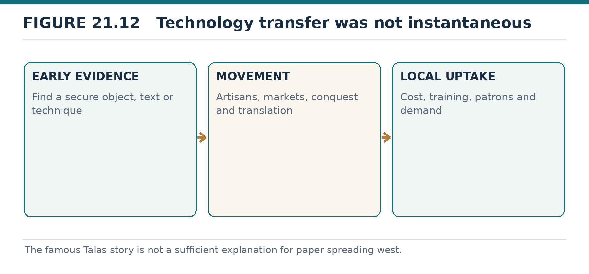

Scholarly exchange was not a passive stream flowing in one direction. Mathematical writings with South Asian roots were examined in Arabic-language scholarship; Greek philosophical and medical traditions were translated and debated through Syriac and Arabic; Chinese Buddhist translators worked with texts whose meanings had to be interpreted across traditions; astronomers combined observation, mathematical modeling and inherited records. The resulting work often went beyond translation into <strong>critique and innovation</strong>.

A physician using a translated medical text needed more than linguistic knowledge. Terms for the body and disease had to be made understandable; treatments might be adapted to local ingredients and practice; claims could be compared with experience. A mathematician receiving numerical techniques could combine them with new problems in taxation, surveying or commerce. The history of knowledge is thus not a race between supposedly isolated “civilizations” to own a discovery. It is a history of people learning from earlier communities and sometimes making genuinely new contributions.

Institutions mattered. Monasteries, mosques, courts, households, libraries, scribal workshops and schools could preserve books and pay knowledgeable people. The same networks could also exclude people who lacked status, money or permission. <strong>Knowledge exchange has political and material conditions</strong>: a manuscript must survive, someone must be able to read it, and some institution or patron must make copying, teaching or observation possible.

<figure class="figure" id="figure-21-12">

<figcaption>Figure 21.12. The famous Talas story is not a sufficient explanation for paper spreading west. <a class="figure-anchor" href="#figure-21-12" aria-label="Link to this figure">#</a></figcaption>
</figure>
