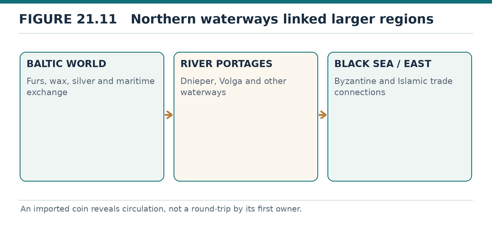

Another map of medieval Eurasia follows rivers rather than deserts. Navigable waterways and portage points linked the Baltic world to the Black Sea and beyond. Scandinavian-origin travelers, often called <strong>Varangians</strong> in eastern sources, interacted with Slavic, Finnic, steppe and Byzantine societies. The political formation usually called <strong>Kievan Rus'</strong> developed through these encounters, regional power struggles and the growth of towns and dynastic institutions. No simple story of either outsiders inventing a state or an ethnically uniform people acting alone captures the complexity.

Trade moved furs, wax, slaves, metals and other goods through river systems. Coins from Islamic lands have been found in northern and eastern Europe; these illustrate contacts, but do not prove that the people who buried them personally visited the caliphate. They could circulate through many intermediate exchanges. Constantinople's prestige attracted diplomats and rulers; the conversion of Vladimir of Kyiv to Christianity around 988, as traditionally narrated, became important for the religious orientation of later eastern Slavic societies. The dates and details of individual episodes should be evaluated against chronicle traditions and other evidence.

This northern network also reminds us that <strong>the Silk Roads were not the whole of Eurasian connectivity</strong>. Northern forests, rivers, steppe passages and sea lanes joined commercial worlds across distances. The routes mattered partly because they connected different ecologies and products: fur-producing northern regions, Mediterranean markets and Central Asian pastoral communities could be linked without any person moving goods from one extreme to the other.

<figure class="figure" id="figure-21-11">

<figcaption>Figure 21.11. An imported coin reveals circulation, not a round-trip by its first owner. <a class="figure-anchor" href="#figure-21-11" aria-label="Link to this figure">#</a></figcaption>
</figure>
