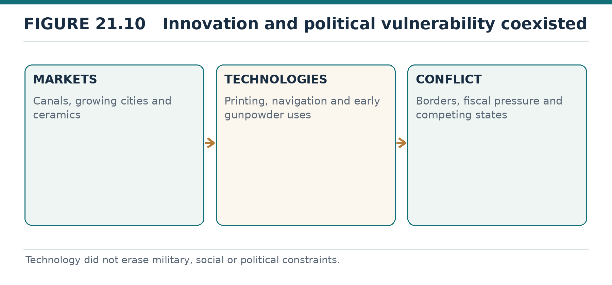

After the fall of the Tang in 907, China underwent periods of political division before reunification under the <strong>Song dynasty</strong> beginning in 960. The Song developed sophisticated administration, commercial cities and expanding market activity, although its rulers also faced serious military pressures from northern neighbors. Agriculture, waterways and urban consumers supported important industries. <strong>Kaifeng</strong> and, later, <strong>Hangzhou</strong> became major centers of production and consumption. Government transport, private enterprise and technological techniques interacted rather than forming separate worlds.

Song-era China saw significant developments in printing, navigation, metallurgy and the military use of gunpowder. But “invented in China” should not be mistaken for “appeared at once in every village” or “spread instantly to Europe.” Different devices had earlier histories, were refined incrementally and reached new places through uncertain pathways. Woodblock printing had been used in East Asia before the Song; movable type developed in China in the eleventh century but was only one technology among several, adapted to linguistic and economic conditions. A device's existence does not guarantee commercial usefulness in every setting.

Song maritime commerce expanded alongside inland transportation. Chinese ceramics circulated widely across Asia and beyond; their widespread archaeological distribution demonstrates commercial reach but not a centrally planned global export strategy. Political competition with the <strong>Liao, Western Xia and Jin</strong> states helps explain why military and fiscal demands remained pressing even amid cultural and commercial achievements. A society can be innovative, wealthy and strategically vulnerable at the same time.

<figure class="figure" id="figure-21-10">

<figcaption>Figure 21.10. Technology did not erase military, social or political constraints. <a class="figure-anchor" href="#figure-21-10" aria-label="Link to this figure">#</a></figcaption>
</figure>
