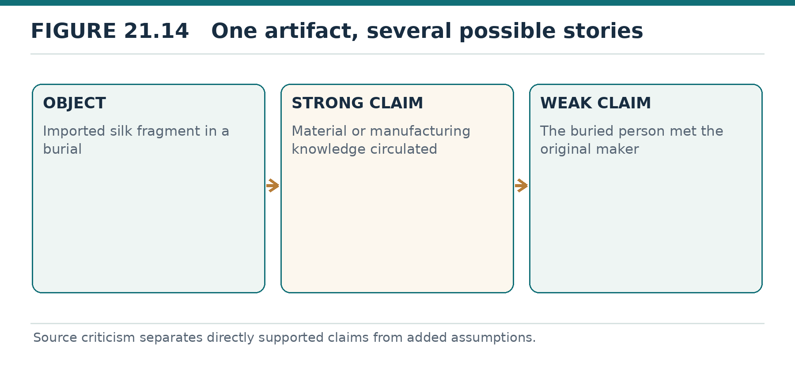

Imagine three sources placed on a historian's desk. The first is a silk fragment found in a medieval Central Asian burial. The second is a monk's travel account describing a foreign city's monasteries. The third is a ruler's inscription proclaiming security on a trade route. All three may be authentic, but they are evidence for different claims.

The textile can be studied for its fibers, weave, dye and archaeological context. Its presence shows that material traveled or was made using techniques that circulated, but cannot independently prove who transported it or why it was buried. The pilgrim may have observed the monasteries directly, yet he also had a religious purpose and could rely on local guides or hearsay for some reports. The royal inscription documents the ruler's claim and policy, not the complete behavior of guards hundreds of kilometers away.

A strong explanation combines these sources without forcing them to say too much. It might add coins that reveal political claims, contracts that document commercial practice, or excavated water channels that show how a town sustained travelers. <strong>The value of a source is relative to the question asked.</strong> This principle, introduced in Chapters 1 and 4, becomes especially powerful when evidence is scattered across continents and languages.

<figure class="figure" id="figure-21-14">

<figcaption>Figure 21.14. Source criticism separates directly supported claims from added assumptions. <a class="figure-anchor" href="#figure-21-14" aria-label="Link to this figure">#</a></figcaption>
</figure>
