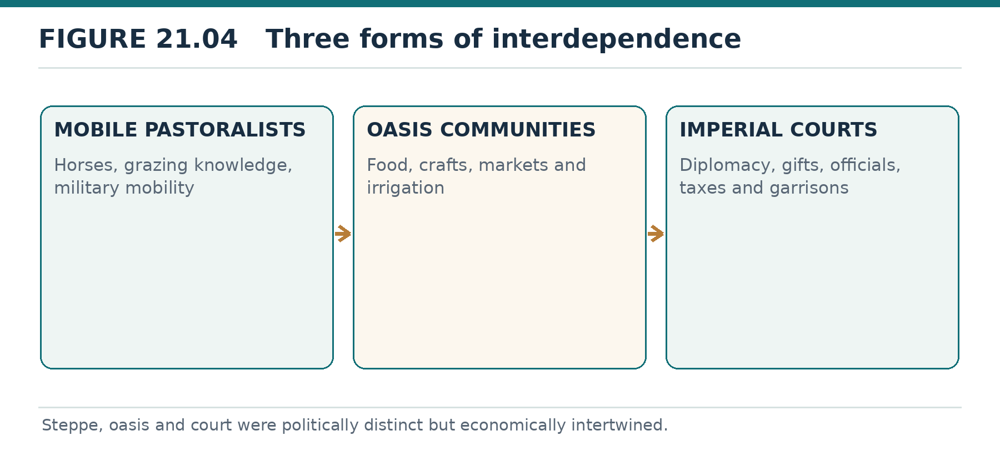

Large-scale exchange also depended on the grassland world. Turkic-speaking confederations, Uighur rulers, Tibetans, Khitan and many other groups shaped the politics of Inner Asia. The term <strong>steppe</strong> describes an ecological zone, not a single civilization, religion or permanent ethnic identity. Mobile pastoralism relied on expert knowledge of seasonal pasture and animals, and it could support formidable cavalry forces. Many mobile communities combined herding with trade, craftwork, farming, raiding or tribute relationships. Nomad and farmer were not sealed categories.

In the sixth century, the <strong>First Turkic Khaganate</strong> emerged as a major political force in Inner Asia. Later Turkic powers interacted with Chinese dynasties, Central Asian cities and Iranian-speaking trading communities. Rulers could offer protection, seek taxes or tribute, intervene in disputed succession, control access to passes, and supply military services. The Uyghur Khaganate, for example, acquired considerable influence on Tang China in the eighth century before its collapse in 840. Its political history shows why a merchant could not judge safety from the fortunes of only one empire.

Older textbooks sometimes present the steppe simply as a source of invasions against settled civilizations. That misses the mutual dependence involved. Settled rulers sought horses, military assistance and diplomatic alliances; steppe elites sought textiles, grain, prestige goods and access to markets. Agreements could create peace, but conflict was recurrent and destructive. A network of exchange was not separate from power: the same people who transported goods could enforce agreements or threaten the roads they used.

<figure class="figure" id="figure-21-4">

<figcaption>Figure 21.4. Steppe, oasis and court were politically distinct but economically intertwined. <a class="figure-anchor" href="#figure-21-4" aria-label="Link to this figure">#</a></figcaption>
</figure>
